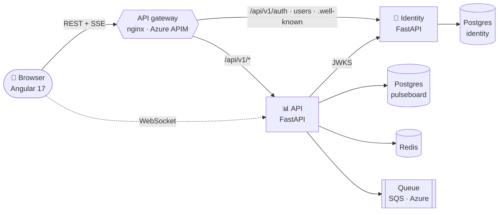

<div align="center">

# 📊 Pulseboard

**Your business metrics, watched for you.**
An assistant builds each person a live board of the metrics they care about, flags the ones moving the wrong way,
and keeps it fresh every hour.

[](https://github.com/Amarnath123122/pulseboard-platform/actions/workflows/ci.yml)
[](https://github.com/Amarnath123122/pulseboard-identity/actions/workflows/ci.yml)
[](https://github.com/Amarnath123122/pulseboard-api/actions/workflows/ci.yml)
[](https://github.com/Amarnath123122/pulseboard-web/actions/workflows/ci.yml)
<br/>


**[🌐 Live demo](https://black-mud-02ef90500.6.azurestaticapps.net)** ·
**[📘 Guide](docs/00-GUIDE.md)** ·
**[🏗️ Architecture](docs/ARCHITECTURE.md)** ·
**[✅ Evidence](docs/EVIDENCE.md)** ·
**[🚀 Deploy](docs/06-DEPLOYMENT.md)**

<br/>


</div>

---

## 🎯 Why Pulseboard exists

### The problem
Teams drown in dashboards. Every department has its own reports, and the numbers that matter get buried among the ones that don't. People find out a metric went wrong **days late**, usually in a meeting, and then lose more time working out *who owns it*, *where the data comes from* and *what to do next*.

### The motive
Pulseboard flips that around: **you shouldn't have to go looking for problems; they should come to you.**

1. **Tell it what you care about once.** A 30-second chat (your team, the areas you watch, your region) replaces hours of dashboard building.
2. **See what needs attention first.** Metrics moving the wrong way rise to the top as alerts. Healthy ones stay quietly in the background.
3. **Get the context, not just the number.** Every alert comes with its trend, regional split, projection, owners, data sources and suggested next steps, so you can act straight away.
4. **Stay current without effort.** The board re-checks itself every hour and updates live on screen, keeping track of what you've already seen or handled.
5. **Run it safely as an organisation.** Real sign-in, roles (Viewer, Editor, Admin) and a managed metric catalog mean the right people see and change the right things.

### Who it's for
| Person | What they get |
|---|---|
| **Team leads and managers** | A morning view of exactly what's off-track in their area, with who to talk to |
| **Analysts and metric owners (Editors)** | One place to define and maintain the metrics everyone watches |
| **Admins** | Control over who has access and what each role can do |

### The engineering motive
Beyond the product, Pulseboard is built as a **reference production-grade application**. It shows, end to end and with working evidence, how to build:
- microservices with a dedicated identity service
- an API gateway
- secure token-based auth with RBAC
- caching without N+1 queries
- realtime updates over SSE and WebSockets
- background queues
- Docker for local parity
- low-cost Azure deployment with infrastructure as code
- CI/CD

The metric data is simulated today, but the shape of the system is the same as a real one: plugging in a real data warehouse or a real AI assistant changes one component, not the architecture.

---

## ✨ Highlights

<table>
<tr>
<td width="33%" valign="top">

### 🤖 Guided setup
A setup assistant **streams** its questions (SSE) and offers clickable answers built from the live metric catalog. Your board is ready seconds later.

</td>
<td width="33%" valign="top">

### 🚨 Alerts first
Metrics moving the wrong way become **HIGH / MEDIUM** alerts. Each one opens a **detail** board (trend, regions, projection) and a **briefing** (owners, sources, next steps).

</td>
<td width="33%" valign="top">

### ⚡ Live and fresh
An hourly reviewer re-grades every board through a **queue**. Updates arrive by **WebSocket**, and your *seen / done* marks are kept.

</td>
</tr>
<tr>
<td valign="top">

### 🔐 Real auth + RBAC
A dedicated **identity microservice**: RS256 tokens with JWKS, **rotating refresh tokens** with theft detection, lockout, and Viewer / Editor / Admin roles.

</td>
<td valign="top">

### 🗂️ Managed catalog
Full **CRUD, search, filters, sort and pagination** for metrics. Nothing is hardcoded; the UI is driven by `/meta` and the runtime `config.json`.

</td>
<td valign="top">

### 🏎️ Built to scale
**Redis cache-aside** with targeted invalidation, **N+1-free** batched endpoints (guarded by tests), stateless services, and a cross-instance event relay.

</td>
</tr>
</table>

---

## 🏗️ Architecture



| Service | Repository | Responsibility |
|---|---|---|
| 🔐 **Identity** | [pulseboard-identity](https://github.com/Amarnath123122/pulseboard-identity) | Accounts, RS256 tokens + JWKS, refresh rotation, RBAC, admin users |
| 📊 **API** | [pulseboard-api](https://github.com/Amarnath123122/pulseboard-api) | Boards, metric catalog, assistant (SSE), reviews (queue), WebSocket, cache |
| 🖥️ **Web** | [pulseboard-web](https://github.com/Amarnath123122/pulseboard-web) | Angular 17 monorepo (app + `data-access` library) |
| 🧩 **Platform** | **this repo** | Gateway, Docker Compose, Azure Bicep, deploy scripts, docs, end-to-end checks |

➡️ The full deep dive, with every diagram and screenshot, is in **[docs/ARCHITECTURE.md](docs/ARCHITECTURE.md)**.

---

## 🚀 Quick start

> Check out all four repositories side by side, then:

```bash
cd pulseboard-platform
docker compose up --build -d
```

| Open | URL |
|---|---|
| App (through the gateway) | **http://localhost:8080** |
| API docs (Swagger) | http://localhost:8000/docs |

**Sign in as** `admin@example.com` / `Admin-Pulseboard-2026`, or create a new account (it starts as Viewer).

<details>
<summary><b>Run without Docker</b></summary>

```powershell
# identity :8100
cd pulseboard-identity; python -m venv .venv; .\.venv\Scripts\python -m pip install -e ".[dev]"; .\.venv\Scripts\python -m uvicorn app.main:app --port 8100
# mock AWS SQS :5000 and API :8000
cd pulseboard-api; python -m venv .venv; .\.venv\Scripts\python -m pip install -e ".[dev]"
.\.venv\Scripts\python -m moto.server -p 5000
.\.venv\Scripts\python -m uvicorn app.main:app --port 8000
# web :5173 (its dev proxy is the gateway)
cd pulseboard-web; npm install; npm start
```
</details>

<details>
<summary><b>Deploy to Azure</b></summary>

```powershell
az login
./scripts/azure-deploy.ps1 -OwnerEmail you@example.com   # infra + identity + api + web + smoke test (~15 min first time)
./scripts/azure-stop.ps1                                 # pause billing, keep data
```
Low-cost setup: one B1 plan hosts both services (~₹35/day). Postgres, API Management, Static Web Apps and monitoring all fit free tiers. Details are in [06-DEPLOYMENT](docs/06-DEPLOYMENT.md).
</details>

---

## 🖼️ Screenshots

| Setup assistant | Briefing board |
|---|---|
|  |  |
| **Metric catalog (Admin)** | **Users and roles (Admin)** |
|  |  |
| **Detail board** | **Live on Azure** |
|  |  |

<sub>All screenshots are real captures, reproducible with <code>scripts/screenshots.py</code>.</sub>

---

## 🌍 Environments

| Environment | Website | Gateway | Status |
|---|---|---|---|
| **Azure (live)** | [black-mud-02ef90500.6.azurestaticapps.net](https://black-mud-02ef90500.6.azurestaticapps.net) | `pb-gw-ktuth67ohzdbe.azure-api.net` (`/identity`, `/core`) | [identity](https://pb-id-ktuth67ohzdbe.azurewebsites.net/readyz) · [api](https://pb-api-ktuth67ohzdbe.azurewebsites.net/readyz) |
| **Docker** | http://localhost:8080 | nginx `:8080` | http://localhost:8080/gateway/health |
| **Dev** | http://localhost:5173 | Angular dev proxy | identity `:8100` · api `:8000` |

---

## 📚 Documentation

| | Document | What you'll find |
|:-:|---|---|
| 📘 | [00 · Guide](docs/00-GUIDE.md) | Everything in one place: flows, services, security, data, run, deploy, troubleshoot |
| ✨ | [01 · Features](docs/01-FEATURES.md) | 22 features with steps, API calls, data and a test checklist |
| 🖥️ | [02 · Frontend](docs/02-FRONTEND.md) | Angular monorepo: files, routing, signals, token refresh, components |
| ⚙️ | [03 · Backend](docs/03-BACKEND.md) | Every endpoint, algorithm, worker and test of both services |
| 🗄️ | [04 · Database](docs/04-DATABASE.md) | Every table and column, migrations, Redis keyspace, queue |
| 🐳 | [05 · Docker](docs/05-DOCKER.md) | Images, compose, gateway config line by line |
| ☁️ | [06 · Deployment](docs/06-DEPLOYMENT.md) | Azure resources, Bicep, Key Vault, APIM, cost, CI/CD |
| 🏗️ | [Architecture](docs/ARCHITECTURE.md) | A-to-Z with 20+ diagrams and real screenshots |
| ✅ | [Evidence](docs/EVIDENCE.md) | 17/17 end-to-end checks on Azure and Docker, CI runs |

---

## 🛡️ Production-grade checklist

| Area | What's in place |
|---|---|
| **Security** | RS256 + JWKS · rotating refresh tokens with reuse detection · scrypt · lockout + gateway rate limits · RBAC on every route · secrets in Key Vault via managed identity · no secrets in git |
| **Reliability** | Stateless services · health and readiness probes · fenced publishing · poison-message handling · graceful degradation when Redis or the queue is down |
| **Performance** | Redis cache-aside · batched `tile-data` (≤3 SQL cold / ≤1 warm, enforced by a test) · SQS batch send · connection pooling |
| **Operability** | JSON logs with request IDs · App Insights · 5xx and budget alerts · one-command deploy and pause |
| **Quality** | 27 automated tests · ruff · CI on every push (unit, Docker integration, infrastructure validation) · end-to-end checks against live Azure |

---

## 🧰 Tech stack

**Backend:** Python 3.12 · FastAPI · SQLAlchemy 2 (async) · Alembic · PyJWT (RS256) · redis-py · boto3 / azure-storage-queue · gunicorn + uvicorn
**Frontend:** Angular 17 (standalone, signals) · TypeScript · RxJS · SSE · WebSocket
**Data:** PostgreSQL 16 · Redis 7 · AWS SQS (moto locally) / Azure Storage Queue
**Platform:** Docker · nginx · Azure App Service · API Management · Static Web Apps · Key Vault · Application Insights · Bicep · GitHub Actions

---

## 📁 Repository layout

```
pulseboard-platform/
├── docker-compose.yml        # the whole system: postgres, redis, sqs, identity, api, web, gateway
├── gateway/nginx.conf        # API gateway (routing, SSE, WebSocket, rate limits, blocked paths)
├── postgres/init.sql         # creates the identity database
├── infra/main.bicep          # Azure infrastructure (App Service, Postgres, APIM, SWA, Key Vault, ...)
├── scripts/
│   ├── azure-deploy.ps1      # one-command deploy + smoke test
│   ├── azure-stop.ps1        # pause billing
│   ├── e2e_check.py          # 17 end-to-end checks (HTTP, SSE, WebSocket)
│   └── screenshots.py        # regenerates docs/images
└── docs/                     # guide, 01–06 deep dives, architecture, evidence, images
```

---

<div align="center">
<sub>Built with FastAPI, Angular and Azure · Questions or issues? Open an issue in the relevant repository.</sub>
</div>
