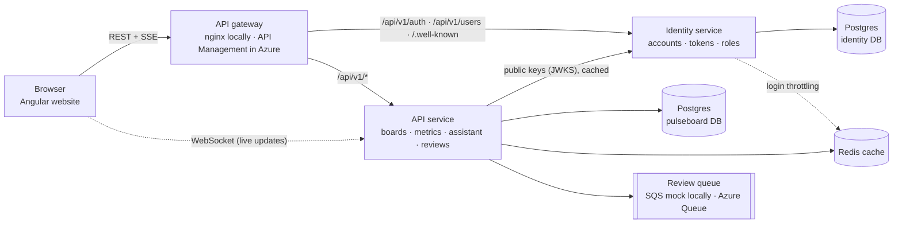
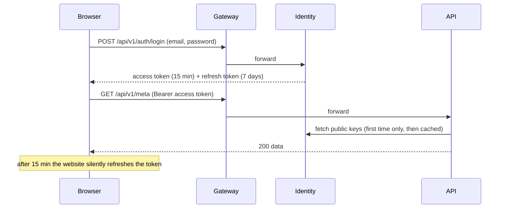
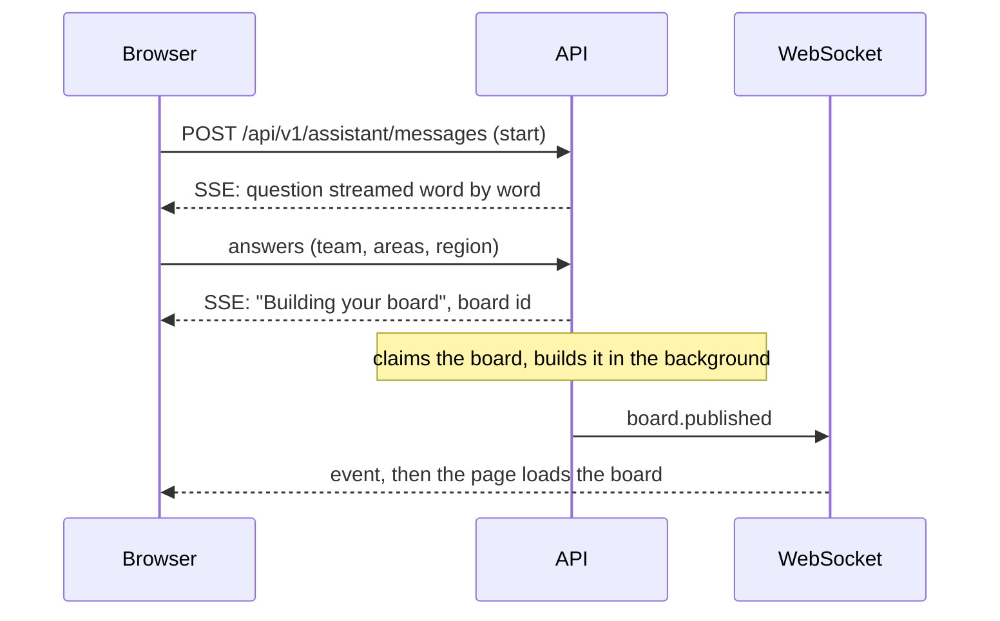
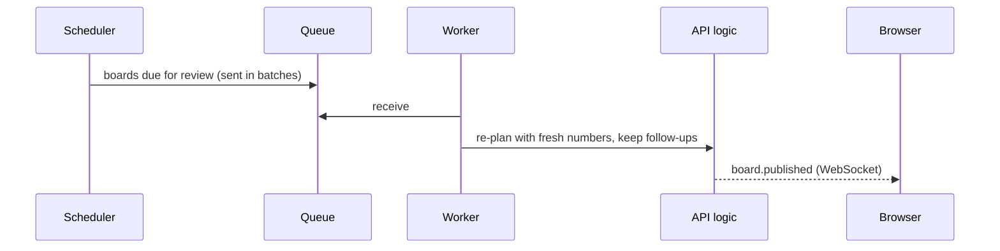

# Pulseboard: the complete guide

> **Start here.** For the granular A-to-Z architecture with diagrams and real screenshots, see **[docs/ARCHITECTURE.md](docs/ARCHITECTURE.md)**.
>
> **This is the only document you need.** It explains what Pulseboard is, how every part works, how to run it, deploy it and fix it, and the proof that it works.

## Repositories and URLs to test

### Repositories (GitHub, private)
| Repo | URL |
|---|---|
| pulseboard-platform (this guide, gateway, compose, Azure infrastructure) | https://github.com/Amarnath123122/pulseboard-platform |
| pulseboard-identity (auth microservice) | https://github.com/Amarnath123122/pulseboard-identity |
| pulseboard-api (domain microservice) | https://github.com/Amarnath123122/pulseboard-api |
| pulseboard-web (Angular website) | https://github.com/Amarnath123122/pulseboard-web |

### Azure (live)
| What | URL |
|---|---|
| **Website** | https://black-mud-02ef90500.6.azurestaticapps.net |
| Gateway: identity | https://pb-gw-ktuth67ohzdbe.azure-api.net/identity/.well-known/jwks.json |
| Gateway: API | https://pb-gw-ktuth67ohzdbe.azure-api.net/core/api/v1/meta (needs a token) |
| Identity health | https://pb-id-ktuth67ohzdbe.azurewebsites.net/readyz |
| API health | https://pb-api-ktuth67ohzdbe.azurewebsites.net/readyz |
| WebSocket | wss://pb-api-ktuth67ohzdbe.azurewebsites.net/ws/events |

**Azure sign-in:**
- **Admin:** `ak6577751@gmail.com`. The password is `adminPassword` in `infra/secrets.local.json` on the deploying machine.
- **Other users:** anyone can create an account (VIEWER).

Swagger docs are switched off in production.

### Local, Docker (`docker compose up --build -d`)
| What | URL |
|---|---|
| **Website (through the gateway)** | http://localhost:8080 |
| Gateway health | http://localhost:8080/gateway/health |
| Identity keys via gateway | http://localhost:8080/.well-known/jwks.json |
| API docs (Swagger, direct) | http://localhost:8000/docs |
| API health (direct) | http://localhost:8000/readyz |
| Postgres | `localhost:5432`, user `pulseboard`, password `pulseboard-local`, databases `pulseboard`, `identity` |

**Local sign-in:** `admin@example.com` / `Admin-Pulseboard-2026`.

### Local, no Docker (see section 9)
| What | URL |
|---|---|
| **Website (dev server, proxies to both services)** | http://localhost:5173 |
| Identity Swagger | http://localhost:8100/docs |
| API Swagger | http://localhost:8000/docs |
| Mock AWS SQS (moto) | http://localhost:5000 |

---

## Contents
1. [What Pulseboard is](#1-what-pulseboard-is)
2. [The four repositories](#2-the-four-repositories)
3. [Architecture in one picture](#3-architecture-in-one-picture)
4. [What a user does (the flows)](#4-what-a-user-does)
5. [Each service in detail](#5-each-service-in-detail)
6. [Security: sign-in, tokens, roles](#6-security-sign-in-tokens-roles)
7. [Data: databases, cache, queue](#7-data-databases-cache-queue)
8. [Realtime: SSE and WebSocket](#8-realtime-sse-and-websocket)
9. [Run it on your laptop](#9-run-it-on-your-laptop)
10. [Deploy to Azure, cost, pause](#10-deploy-to-azure-cost-pause)
11. [CI/CD pipelines](#11-cicd-pipelines)
12. [Configuration (no hardcoded data)](#12-configuration-no-hardcoded-data)
13. [Troubleshooting](#13-troubleshooting)
14. [Evidence that it works](#14-evidence-that-it-works)
15. [Glossary](#15-glossary)

---

## 1. What Pulseboard is

Pulseboard builds each person a **board** of business metrics and keeps it up to date.

1. You **sign in**.
2. A **setup assistant** asks three questions: your team, the areas to watch (sales, customers, operations…) and your region.
3. It builds your **overview board**:
   - one **tile** per metric
   - metrics that moved the wrong way become **alerts** (HIGH or MEDIUM) and are listed first
4. Each alert opens:
   - a **detail board**: 12-week trend, split by region, 4-week projection
   - a **briefing board**: summary, owners, data sources, next steps
5. You mark alerts **seen** or **done**.
6. Every hour a background **reviewer** rebuilds your board with fresh numbers, keeping your seen and done marks. The screen updates live.
7. Admins manage the **metric catalog** (what can be watched) and **users** (who can do what).

The metric numbers come from a built-in **mock data source** with realistic, deterministic values. A real data warehouse would plug in behind the same interface.

---

## 2. The four repositories

| Repo | What it is | Tech |
|---|---|---|
| [pulseboard-identity](https://github.com/Amarnath123122/pulseboard-identity) | **Auth microservice**: accounts, sign-in, tokens, roles (RBAC) | FastAPI, Postgres, Redis |
| [pulseboard-api](https://github.com/Amarnath123122/pulseboard-api) | **Domain microservice**: boards, metrics, assistant, reviews | FastAPI, Postgres, Redis, SQS / Azure Queue |
| [pulseboard-web](https://github.com/Amarnath123122/pulseboard-web) | **Website**: Angular monorepo (app + `data-access` library) | Angular 17 |
| **pulseboard-platform** (this repo) | **Glue**: API gateway, Docker Compose, Azure infrastructure, deploy scripts, this guide | nginx, Bicep, PowerShell |

Check all four out side by side:
```
pulseboard-platform/   pulseboard-identity/   pulseboard-api/   pulseboard-web/
```

---

## 3. Architecture in one picture



**Ground rules:**
- **The browser only talks to the gateway,** except for the live WebSocket.
- **The gateway routes by path** and never exposes internal or debug endpoints.
- **Each service owns its database.** They share one Postgres server, which costs nothing extra, but never each other's tables.
- **Only identity holds the signing key.** The API checks tokens with identity's **public** keys, so no secret is shared.

---

## 4. What a user does

### 4.1 Sign in


### 4.2 Set up a board


### 4.3 Read a board
- **Board page:** `GET /api/v1/boards/{id}` and `GET /api/v1/boards/{id}/tiles`.
- **All tile values at once:** `GET /api/v1/boards/{id}/tile-data`. That's one request for the whole board, not one per tile.
- **Failures stay contained:** a tile whose data fails shows its own error; the rest of the board still loads.

### 4.4 Hourly review


### 4.5 Website pages

| Page | Who | What |
|---|---|---|
| Sign in / Create account | everyone | email and password; new accounts are **Viewer** |
| Overview | signed in | alerts first, priority legend, live updates |
| My boards | signed in | search, filter by kind, pagination |
| Detail / Briefing | signed in | breadcrumbs `Overview › Detail` |
| Metric catalog | Viewer: read-only · Editor/Admin: create, edit, delete | search, area filter, sort, pagination |
| Activity | signed in | setup and review jobs; refreshes live |
| Setup assistant | signed in | progress bar and clickable answer suggestions |
| Users | **Admin only** | search, change role, activate/deactivate |

---

## 5. Each service in detail

### 5.1 Identity (`pulseboard-identity`)
| Endpoint | Purpose |
|---|---|
| `POST /api/v1/auth/register` | create an account (role: VIEWER) |
| `POST /api/v1/auth/login` | sign in; locks out after 5 failures |
| `POST /api/v1/auth/refresh` | new token pair; the old refresh token dies |
| `POST /api/v1/auth/logout` | end the session |
| `GET /api/v1/auth/me` | who am I, plus my permissions |
| `GET /api/v1/auth/roles` | what each role may do |
| `GET/PATCH /api/v1/users…` | admin user management |
| `GET /.well-known/jwks.json` | public keys the API uses to check tokens |
| `GET /healthz`, `/readyz` | health |

**Code tour:**
- `app/security.py`: passwords, signing keys, the role map.
- `app/service.py`: accounts and sessions.
- `app/routes.py`: the endpoints.

### 5.2 API (`pulseboard-api`)
| Endpoint | Permission |
|---|---|
| `POST /api/v1/assistant/messages` (SSE) | `setup:run` |
| `GET /api/v1/boards`, `/boards/{id}`, `/boards/{id}/tiles`, `/boards/{id}/tile-data`, `/meta` | `boards:read` |
| `PATCH /api/v1/tiles/{id}/follow-up` | `boards:follow_up` |
| `GET /api/v1/metrics…` | `metrics:read` |
| `POST/PUT/DELETE /api/v1/metrics…` | `metrics:write` |
| `GET /api/v1/jobs` | `jobs:read` |
| `WS /ws/events?token=…` | valid token |
| `/internal/v1/*` | service key only; **never** routed by the gateway |

**Code tour:**

| File | What it does |
|---|---|
| `app/api/` | Routes |
| `app/assistants/` | Setup chat, planner, reviewer |
| `app/services/layout.py` | Safe publishing |
| `app/services/catalog.py` | Metric CRUD |
| `app/services/cache.py`, `keys.py` | Redis |
| `app/services/queue.py`, `workers.py` | Queue and background workers |
| `app/services/events.py` | WebSocket and cross-instance relay |

**Safe publishing:** a board is **claimed** before it's rebuilt, and each claim gets a new **generation** number. Only the current claim holder can publish, and everything is written in one transaction. A slow or abandoned job can never overwrite newer work.

### 5.3 Website (`pulseboard-web`)
| Piece | Role |
|---|---|
| `projects/pulseboard/` | The app: pages, routing, sidebar, styles |
| `projects/data-access/` | The library: API and auth clients, session, token refresh, WebSocket, settings and toast services |
| `/config.json` | `apiUrl`, `authUrl`, `wsUrl`, read when the app loads, so **one build works everywhere** |

**Session handling:**
- **Refresh:** when a request gets 401, the website refreshes the token once and retries. Several requests waiting at once share a single refresh.
- **Failure:** if the refresh fails too, the user is signed out.

### 5.4 Gateway (`gateway/nginx.conf` locally, API Management in Azure)
| Path | Goes to |
|---|---|
| `/api/v1/auth/*`, `/api/v1/users*`, `/.well-known/*` | identity |
| `/api/*`, `/ws/*` | api |
| `/internal/*`, `/docs`, `/openapi.json` | **blocked** |
| everything else | website |

**What the gateway also does:**
- rate limits: 10 requests/s for auth and 50/s for the API, per IP
- request IDs for tracing
- streaming without buffering, so the assistant's replies stream (SSE)
- security headers
- in Azure, it also answers CORS

---

## 6. Security: sign-in, tokens, roles

### 6.1 Roles and permissions
| Permission | Viewer | Editor | Admin |
|---|:-:|:-:|:-:|
| read boards and tiles, mark follow-ups, run setup, see activity | ✓ | ✓ | ✓ |
| read the metric catalog | ✓ | ✓ | ✓ |
| create, edit or delete metrics | | ✓ | ✓ |
| manage users | | | ✓ |

- **One map:** the role → permission map lives in exactly one place, `pulseboard-identity/app/security.py`. Tokens carry the permissions, and the API only reads them.
- **Ownership on top:** your boards are yours. Anyone else gets "not found", which doesn't reveal that they exist.

### 6.2 How each risk is handled
| Risk | Protection |
|---|---|
| Stolen password database | Passwords hashed with scrypt and a per-user salt |
| Guessing passwords | 5 failures per email or per IP, then a 15-minute lockout; gateway rate limits |
| Finding out who has an account | Same message and same timing for "no such user" and "wrong password" |
| Stolen refresh token | It changes on every use; reusing an old one ends the whole session |
| Forged tokens | RS256 signatures; only identity has the private key (in Key Vault in Azure) |
| Old permissions lingering | A role change or deactivation ends the user's sessions (≤15 min) |
| Locking everyone out | The last active admin can't be demoted or deactivated |
| Internal endpoints | Not routed by any gateway; they need a service key |
| Secrets in code | None. Local: `.env` files. Azure: Key Vault. The services refuse to start in production with default secrets. |

---

## 7. Data: databases, cache, queue

### 7.1 Databases
| Database | Owner | Tables |
|---|---|---|
| `identity` | identity | `users`, `refresh_tokens` |
| `pulseboard` | api | `boards`, `board_versions`, `tiles`, `metrics`, `user_preferences`, `assistant_profiles`, `assistant_jobs`, `conversations`, `conversation_messages` |

- **Schema changes** use **Alembic** migrations, run automatically on every start.
- **Locally without Docker,** SQLite is used, so no install is needed.

### 7.2 Redis cache
Writes go to the database first, then clear only the affected keys (cache-aside).

| Key | Holds | Cleared when |
|---|---|---|
| `catalog:v1` | the metric catalog | any metric change |
| `metrics:list:*` | catalog search pages | any metric change |
| `board:<id>` | a board | the board is republished |
| `tiles:<board>` | a board's tiles | republished, or a follow-up changes |
| `tile:<tile>:<hour>` | one tile's numbers | a metric changes; also hourly |
| `boards:<user>:*` | "My boards" pages | that user's board is republished |
| `login:fail:*` | sign-in failure counters | after 15 minutes, or a successful sign-in |

**If Redis is down, the app still works** from the database.

The mode is set with `PB_CACHE_BACKEND`:
- `redis` in Docker
- `memory` for a single local process
- `none` in Azure by default, to save cost

### 7.3 Performance (N+1 problems fixed)
| Before | After |
|---|---|
| one request per tile | one request per board |
| two queries to check a tile's owner | one joined query |
| one count query per board | one grouped query |
| one queue message per call | batches of 10 |

A test **counts SQL statements**: a whole board's tile data takes at most 3 queries cold and 1 warm, however many tiles there are.

### 7.4 Queue
- **Locally:** AWS SQS, mocked by **moto**.
- **In Azure:** Azure Storage Queue, accessed with managed identity and no keys.
- **Delivery:** messages are retried, and a message that fails 5 times is dropped and logged.

---

## 8. Realtime: SSE and WebSocket

| Channel | Use |
|---|---|
| **SSE** (`POST /api/v1/assistant/messages`) | The assistant's replies appear word by word |
| **WebSocket** (`/ws/events`) | `board.building` / `board.published` → boards refresh, Activity refreshes, a toast appears. Reconnects automatically; pings every 25 s. |
| **Postgres LISTEN/NOTIFY** | Passes events between API instances, so live updates work with several servers |

The sidebar shows **"Live updates on"** when the WebSocket is connected.

---

## 9. Run it on your laptop

### Option A: Docker, the whole system (recommended)
```bash
cd pulseboard-platform
docker compose up --build -d
```
- **Open:** http://localhost:8080.
- **Sign in:** `admin@example.com` / `Admin-Pulseboard-2026`.
- **Contents:** Postgres, Redis, mock SQS, identity, API, website and gateway.
- **Stop:** `docker compose down`. Add `-v` to also delete the data.

### Option B: no Docker (for coding)
```powershell
# terminal 1 – identity
cd pulseboard-identity; python -m venv .venv; .\.venv\Scripts\python -m pip install -e ".[dev]"; copy .env.example .env
.\.venv\Scripts\python -m uvicorn app.main:app --reload --port 8100
# terminal 2 – mock AWS queue
cd pulseboard-api; python -m venv .venv; .\.venv\Scripts\python -m pip install -e ".[dev]"; copy .env.example .env
.\.venv\Scripts\python -m moto.server -p 5000
# terminal 3 – API
.\.venv\Scripts\python -m uvicorn app.main:app --reload --port 8000
# terminal 4 – website (its dev proxy acts as the gateway)
cd pulseboard-web; npm install; npm start          # http://localhost:5173
```

### Tests
```powershell
cd pulseboard-identity; .\.venv\Scripts\python -m pytest -q     # 7 tests
cd pulseboard-api;      .\.venv\Scripts\python -m pytest -q     # 20 tests
cd pulseboard-web;      npm run build
python pulseboard-platform/scripts/e2e_check.py --name local --auth http://localhost:8080 --api http://localhost:8080 `
  --ws ws://localhost:8080/ws/events --admin-email admin@example.com --admin-password Admin-Pulseboard-2026
```

---

## 10. Deploy to Azure, cost, pause

```powershell
az login
cd pulseboard-platform
./scripts/azure-deploy.ps1 -OwnerEmail you@example.com             # everything + smoke test
./scripts/azure-deploy.ps1 -OwnerEmail you@example.com -SkipInfra  # code only
./scripts/azure-stop.ps1                                           # pause billing, keep data
az group delete -n rg-pulseboard                                   # delete everything
```

**What the deploy does (safe to re-run):**
1. Creates secrets once in `infra/secrets.local.json`, which git ignores: the database password, service key, admin password and signing key.
2. Creates or updates the infrastructure (`infra/main.bicep`).
3. Wakes paused services.
4. Uploads identity and api, then waits until both report ready. It retries if Azure is still busy with a previous upload.
5. Builds the website with the right `config.json` and uploads it.
6. Signs in as admin **through the gateway** and calls the API, as a smoke test.

**Azure resources (Central India):**

| Resource | Tier | Cost |
|---|---|---|
| App Service plan (runs **both** identity and api) | B1 | ~₹35/day |
| PostgreSQL Flexible Server (two databases) | B1ms, 32 GB | free (750 h/month for 12 months) |
| API Management (gateway) | Consumption | first 1M calls/month free |
| Static Web Apps (website) | Free | ₹0 |
| Key Vault, Storage Queue | Standard | ≈₹0 |
| Application Insights + Log Analytics | 0.15 GB/day cap | free allowance |
| Alerts | 5xx alert + monthly budget email | free |
| Azure Managed Redis | optional, `-DeployRedis` | ~₹40–50/day, off by default |

**Admin in Azure:**
- **Email:** the `OwnerEmail` you deployed with.
- **Password:** `adminPassword` in `infra/secrets.local.json`.

---

## 11. CI/CD pipelines

| Repo | Every push runs | On `main` |
|---|---|---|
| identity | lint, 7 tests, Docker image boots on Postgres (keys and admin login checked) | n/a |
| api | lint, 20 tests (roles, cache, N+1 guard), Docker image against Postgres, Redis and mock SQS, full demo | deploys to App Service once Azure secrets are set |
| web | app build, library build, Docker build | uploads to Static Web Apps once configured |
| platform | infrastructure compiles, compose is valid, gateway config is valid | n/a |

---

## 12. Configuration (no hardcoded data)

| Data | Where it comes from |
|---|---|
| Metric catalog | `metrics` database table, managed on the Metric catalog page |
| Setup question choices (areas) | the catalog |
| Regions, units, page sizes | settings, served by `GET /api/v1/meta` |
| Roles and permissions | identity, served by `GET /api/v1/auth/roles` |
| Website endpoints | `/config.json`, written at deploy time |

| Service | Prefix | Main settings |
|---|---|---|
| identity | `ID_` | `DATABASE_URL`, `JWT_PRIVATE_KEY_B64`, `ACCESS_TOKEN_MINUTES`, `REFRESH_TOKEN_DAYS`, `SIGNUP_ROLE`, `BOOTSTRAP_ADMIN_EMAIL/PASSWORD`, `REDIS_URL` |
| api | `PB_` | `DATABASE_URL`, `JWKS_URL`, `CACHE_BACKEND`, `REDIS_URL`, `QUEUE_BACKEND`, `REGIONS`, `UNITS`, `PAGE_SIZES`, `SERVICE_KEY` |
| web | `/config.json` | `apiUrl`, `authUrl`, `wsUrl` |

---

## 13. Troubleshooting

| Problem | Fix |
|---|---|
| Admin password rejected | Locally: `Admin-Pulseboard-2026`. Azure: `adminPassword` in `infra/secrets.local.json`. |
| "Too many failed sign-in attempts" | Wait 15 minutes |
| 403 "You don't have permission" | An admin changes your role on the Users page; sign in again |
| Every request returns 401 | The API can't reach identity's keys; check `PB_JWKS_URL` |
| "Reconnecting…" in the sidebar | Check `wsUrl` in `/config.json` |
| Website can't load its configuration | Redeploy, or set `API_URL`/`AUTH_URL`/`WS_URL` for the web container |
| Azure 503 right after a deploy | Wait 3–5 minutes for installs; then `az webapp log tail -g rg-pulseboard -n <app>` |
| Docker "port already allocated" | Stop local servers on 5000, 8000, 8100 or 5173 |

---

## 14. Evidence that it works

`scripts/e2e_check.py` makes real HTTP, SSE and WebSocket calls through the gateway. **17 of 17 checks pass on live Azure and in Docker.**

| # | Check | Azure | Docker |
|---|---|---|---|
| 1 | Identity publishes signing keys (RS256) | ✅ | ✅ |
| 2 | Admin signs in through the gateway | ✅ | ✅ |
| 3 | Wrong password is rejected (401) | ✅ | ✅ |
| 4 | New user registers as Viewer | ✅ | ✅ |
| 5 | API rejects an invalid token (401) | ✅ | ✅ |
| 6 | API accepts identity tokens, serves `/meta` | ✅ | ✅ |
| 7 | Viewer cannot create metrics (403, `metrics:write` missing) | ✅ | ✅ |
| 8 | Admin creates a metric (201) | ✅ | ✅ |
| 9 | Search and pagination (Docker: second call served from Redis) | ✅ | ✅ |
| 10 | Update then delete (200, 204, then 404) | ✅ | ✅ |
| 11 | Only admin can list users | ✅ | ✅ |
| 12 | Assistant streams its reply (SSE, 55 chunks) | ✅ | ✅ |
| 13 | WebSocket pushes `board.building` → `board.published` | ✅ | ✅ |
| 14 | Board is live; all tile data in one call | ✅ | ✅ |
| 15 | Another user cannot see your board (404) | ✅ | ✅ |
| 16 | Gateway blocks `/internal` (404) | ✅ | ✅ |
| 17 | Refresh token rotates; reusing the old one is refused | ✅ | ✅ |

The full timestamped reports, the CORS proof and the CI run links are in [docs/EVIDENCE.md](docs/EVIDENCE.md).

---

## 15. Glossary

| Term | Meaning |
|---|---|
| Board / tile | A page of metrics / one metric on it |
| Alert | A tile whose metric moved the wrong way (HIGH or MEDIUM) |
| Detail / Briefing | The pages behind an alert: charts / context and next steps |
| Access token | Short-lived (15 min) proof of who you are, sent with every request |
| Refresh token | Longer-lived (7 days) token used only to get a new access token; changes on every use |
| JWKS | The identity service's public keys, used to check tokens |
| RBAC | Role-based access control: Viewer, Editor, Admin |
| Gateway | The single front door that routes requests to the right service |
| SSE | Server-Sent Events: the server streams text to the browser over one request |
| WebSocket | A two-way live connection, used for board updates |
| Cache-aside | Read the cache, fall back to the database, store the result; writes clear the cache |
| N+1 | Doing one query or request per item instead of one for all |
| moto | A local fake of AWS, used for the queue |
