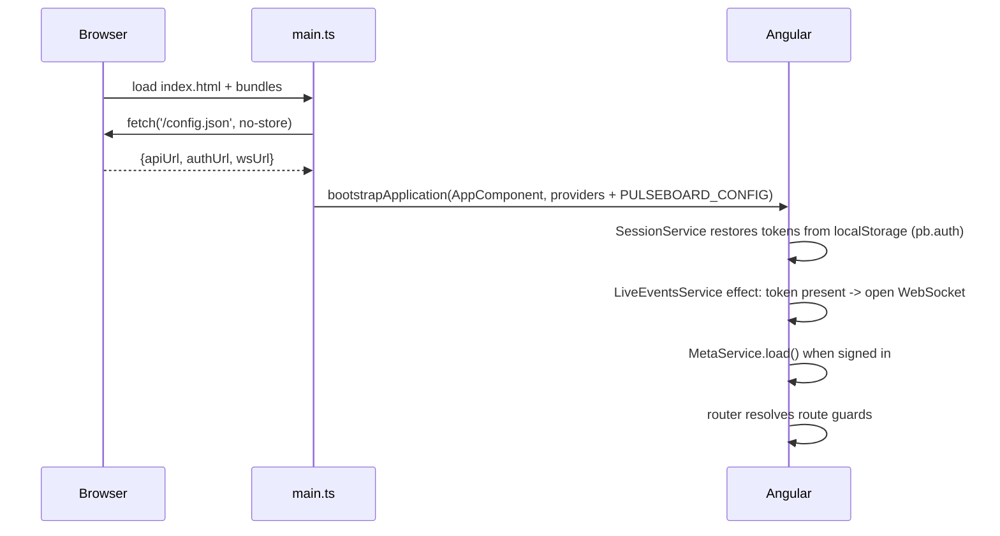

# 02 · Frontend, A to Z (`pulseboard-web`)

> Series: [01 Features](01-FEATURES.md) · **02 Frontend** · [03 Backend](03-BACKEND.md) · [04 Database](04-DATABASE.md) · [05 Docker](05-DOCKER.md) · [06 Deployment](06-DEPLOYMENT.md)

---

## 1. Stack and versions
| Item | Value |
|---|---|
| Framework | Angular **17.3** (standalone components, signals, built-in control flow `@if/@for/@switch`) |
| Language | TypeScript 5.4 (strict) |
| Build | `@angular-devkit/build-angular:application` (esbuild) |
| Workspace | Angular CLI **monorepo**: app `pulseboard` + library `data-access` |
| Styling | One global stylesheet with CSS variables (light/dark), no UI framework |
| Charts | Hand-written SVG (trend lines), CSS bars; no chart library |
| Runtime config | `/config.json`, fetched before bootstrap |
| Node | 18.19+ locally; 20 in CI and Docker |

## 2. Workspace layout
```
pulseboard-web/
├─ angular.json                 projects: pulseboard (app), data-access (library)
├─ tsconfig.json                paths: "data-access" -> projects/data-access/src/public-api.ts (source, no prebuild)
├─ package.json                 scripts: start, build, build:lib
├─ Dockerfile                   node:20 build -> nginx-unprivileged runtime
├─ docker/nginx.conf            SPA fallback, caching, security headers
├─ docker/write-config.sh       writes /config.json from API_URL/AUTH_URL/WS_URL at container start
├─ .github/workflows/ci.yml     npm ci, build app + lib, docker build
├─ .github/workflows/deploy.yml Static Web Apps upload with per-environment config.json
└─ projects/
   ├─ data-access/src/
   │  ├─ public-api.ts          exports everything below
   │  └─ lib/
   │     ├─ config.ts           PULSEBOARD_CONFIG token {apiUrl, authUrl, wsUrl}
   │     ├─ models.ts           Board, Tile, TileData, QueryResult, Metric, Page<T>, Meta, Job, BoardSummary…
   │     ├─ session.service.ts  signals: token, refreshToken, user, signedIn; can(permission)
   │     ├─ auth.service.ts     register, login, refresh (single-flight), logout, roles, users, updateUser
   │     ├─ auth.interceptor.ts adds Bearer; on 401 refresh once then retry; else logout
   │     ├─ api.service.ts      boards, tiles, tile-data, follow-up, meta, boards list, jobs, metrics CRUD, SSE
   │     ├─ live-events.service.ts  WebSocket, reconnect + ping, last event signal
   │     ├─ meta.service.ts     cached /meta signal
   │     └─ toast.service.ts    transient notifications
   └─ pulseboard/
      ├─ proxy.conf.json        dev gateway: /api/v1/auth|users, /.well-known -> :8100 ; /api, /ws -> :8000
      ├─ staticwebapp.config.json  SPA fallback + headers for Azure Static Web Apps
      ├─ public/config.json     local default runtime config
      └─ src/
         ├─ main.ts             fetch /config.json -> bootstrapApplication
         ├─ styles.css          tokens, shell, tiles, tables, forms, toasts, auth, responsive
         └─ app/
            ├─ app.config.ts    router (component input binding), HttpClient + authInterceptor
            ├─ app.routes.ts    routes + guards (signedIn, signedOut, can(permission))
            ├─ app.component.ts shell: sidebar, role-aware nav, live status, user card, toasts
            └─ pages/
               ├─ sign-in.page.ts   tabs: sign in / create account
               ├─ setup.page.ts     SSE chat, progress bar, answer chips
               ├─ board.page.ts     overview/detail/briefing, building state, breadcrumbs, legend
               ├─ tile-card.component.ts  STAT / TREND (SVG) / BREAKDOWN, follow-up actions
               ├─ boards.page.ts    My boards table
               ├─ activity.page.ts  jobs table, live refresh
               ├─ metrics.page.ts   catalog table + create/edit form + inline delete confirm
               ├─ users.page.ts     admin users + role matrix
               └─ pager.component.ts shared pagination bar
```

## 3. Boot sequence

If `/config.json` fails to load, the page shows "Pulseboard could not load its configuration."

## 4. Routing and guards
| Path | Component | Guard | Title |
|---|---|---|---|
| `/sign-in` | SignInPage | `signedOut` (signed-in users go to `/`) | Sign in · Pulseboard |
| `/` | BoardPage (overview) | `signedIn` | — |
| `/boards` | BoardsPage | `signedIn` | My boards · Pulseboard |
| `/boards/:id` | BoardPage (detail/briefing) | `signedIn` | — |
| `/metrics` | MetricsPage | `signedIn` | Metric catalog · Pulseboard |
| `/activity` | ActivityPage | `signedIn` | Activity · Pulseboard |
| `/setup` | SetupPage | `signedIn` | Setup · Pulseboard |
| `/users` | UsersPage | `can('users:read')` (others go to `/`) | Users · Pulseboard |
| `**` | redirect `/` | | |

- **Lazy loading:** every page is `loadComponent` (lazy), so its code downloads on first visit.
- **Inputs:** route parameters arrive as component inputs (`withComponentInputBinding`), for example `BoardPage.id`.

## 5. State management (signals)
| Signal | Owner | Meaning |
|---|---|---|
| `session.token / refreshToken / user / signedIn` | SessionService | Persisted in `localStorage["pb.auth"]` |
| `session.can(p)` | SessionService | Permission check from `user.permissions` |
| `live.connected / last` | LiveEventsService | WebSocket status and the latest event |
| `meta.meta` | MetaService | regions, units, areas, page sizes, enums |
| `toast.toasts` | ToastService | visible notifications (auto-dismiss after 4 s) |
| Page-local signals | each page | data, filters, busy and error flags |

## 6. HTTP layer
| Client | Base URL | Used for |
|---|---|---|
| `AuthService` | `config.authUrl` | `/api/v1/auth/*`, `/api/v1/users*` |
| `ApiService` | `config.apiUrl` | all `/api/v1/*` domain calls |
| `ApiService.assistantTurn` | `config.apiUrl` | `fetch` + `ReadableStream` (EventSource can't POST) |
| `LiveEventsService` | `config.wsUrl?token=…` | WebSocket |

**Interceptor (`authInterceptor`), in order:**
1. Skip the auth endpoints themselves (login, register, refresh, logout).
2. Add `Authorization: Bearer <access>`.
3. On **401**, if a refresh token exists, call `auth.refresh()`. The call is single-flight: concurrent 401s share one `shareReplay` observable.
4. Retry the original request with the new token.
5. If the refresh fails, call `auth.logout()`, which clears the session and goes to `/sign-in`.

The SSE `fetch` bypasses the interceptor, so it handles 401 itself with `auth.freshToken()` and a single retry.

### 6.1 Every call the UI makes
| Page | Calls |
|---|---|
| Sign in | `POST auth/login` · `POST auth/register` |
| Shell | `GET /meta` · WS `/ws/events` · `POST auth/logout` |
| Setup | `POST /assistant/messages` (SSE) x 4 |
| Overview | `GET /boards/overview` → `GET /boards/{id}/tiles` → `GET /boards/{id}/tile-data` |
| Detail / Briefing | `GET /boards/{id}` → tiles → tile-data |
| Tile actions | `PATCH /tiles/{id}/follow-up` |
| My boards | `GET /boards?q&kind&page&size` |
| Activity | `GET /jobs?job_type&status&page&size` |
| Metric catalog | `GET /metrics…` · `POST /metrics` · `PUT /metrics/{key}` · `DELETE /metrics/{key}` |
| Users | `GET /users…` · `PATCH /users/{id}` · `GET auth/roles` |

## 7. Components in detail
### 7.1 `TileCardComponent`
| Input / output | Type |
|---|---|
| `tile` | `Tile` (required) |
| `data` | `TileData` |
| `changed` | output, emitted after a follow-up change |

**Rendering by result shape:**
- `stat`: a big number plus a delta coloured by `higher_is_better`.
- `series`: an SVG polyline in a 320×110 viewBox. Projected points are drawn dashed.
- `categories`: bar rows.

**Number format (`fmt`):**

| Unit | Example | Rule |
|---|---|---|
| `%` | `96.13%` | two decimals at ≥ 99, otherwise one |
| `USD` | `$172K`, `$1.25M` | |
| `x` | `2.26×` | |
| counts (whole numbers) or values ≥ 100 | `89 tickets` | rounded, thousands separators |
| other | `7.2 days` | one decimal |

### 7.2 `BoardPage`
1. `load()` fetches the board.
2. If the board is BUILDING, it polls every 3 s.
3. Otherwise it loads the tiles, then the batched tile data.
4. An `effect` refetches when `live.last()` is a `board.*` event for this board or its parent.
5. A 404 on the overview redirects to `/setup`.

### 7.3 `SetupPage`
- **Answer chips:**
  - step 1 offers `meta.areas` (multi-select)
  - step 2 offers `["All regions", …meta.regions]` (single click sends)
- **Progress bar:** reflects `turn.end.step`.
- **After `board`:** the page navigates to `/` after 900 ms.

### 7.4 `MetricsPage`
- **Query:** a signal of `{q, area, page, size, sort, desc}`.
- **Search:** debounced by 300 ms.
- **Edit form:** lists are entered as comma-separated text.
- **Delete:** confirmed inline.
- **Permissions:** `canWrite = computed(() => session.can('metrics:write'))` hides the write controls.

### 7.5 `UsersPage`
- **Role dropdown:** each row has one, and changing it fires `PATCH`.
- **Activate/Deactivate:** a button on every row except your own.
- **Role matrix:** shown in a `<details>` block, loaded from `GET auth/roles`.

### 7.6 `PagerComponent`
- **Inputs:** `total`, `page`, `pages`, `size`, `sizes`, `noun`, `cached`.
- **Outputs:** `pageChange`, `sizeChange`.

## 8. Styling system
| Token | Light | Dark |
|---|---|---|
| `--bg` | `#f6f7f9` | `#111418` |
| `--surface` | `#fff` | `#1a1e24` |
| `--text` | `#1b1f24` | `#e7eaee` |
| `--accent` | `#3657d6` | `#7b95ff` |
| `--good` / `--bad` / `--warn` | `#1f8a4c` / `#c4302b` / `#b7791f` | same |

**Layout rules:**
- **Shell:** `.shell` is a 240 px sidebar plus the content area. Below 760 px it becomes a single column with the sidebar as a top bar.
- **Accessibility:**
  - `:focus-visible` outlines
  - `aria-live` on chat, toasts and the building state
  - `role="progressbar"` on the setup progress
  - `prefers-reduced-motion` turns off the shimmer and pulse animations

## 9. Build, run, test
```bash
npm install
npm start                 # ng serve pulseboard --port 5173 with proxy.conf.json (dev gateway)
npm run build             # production build → dist/pulseboard/browser
npx ng build data-access  # library build (also run in CI)
```
**Production budgets:**
- initial bundle: warn at 500 KB, error at 1 MB
- per-component styles: warn at 4 KB, error at 8 KB

## 10. Runtime config per environment
| Environment | `apiUrl` | `authUrl` | `wsUrl` | Written by |
|---|---|---|---|---|
| `npm start` | `""` | `""` | `ws://localhost:5173/ws/events` | `public/config.json` |
| Docker | `""` | `""` | `ws://localhost:8080/ws/events` | `write-config.sh` from env |
| Azure | `https://pb-gw-…/core` | `https://pb-gw-…/identity` | `wss://pb-api-…/ws/events` | `azure-deploy.ps1` / `deploy.yml` |

An empty string means "same origin". The request goes to whatever gateway served the page.

## 11. Security in the browser
| Topic | Choice |
|---|---|
| Token storage | `localStorage` (short 15-min access token, rotating refresh token). Roadmap: httpOnly cookie behind a same-site gateway. |
| XSS | Angular escapes every interpolation; no `innerHTML` with user data |
| Clickjacking | `X-Frame-Options: DENY` (nginx, SWA config) |
| MIME sniffing | `X-Content-Type-Options: nosniff` |
| Referrer | `no-referrer` |
| Authorization | UI guards are UX only. The APIs enforce every permission. |
