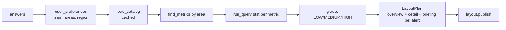
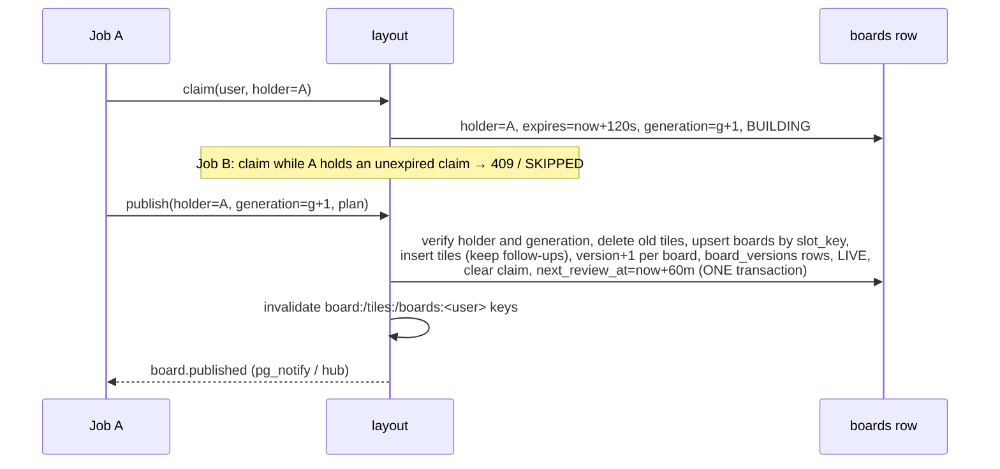

# 03 · Backend, A to Z (`pulseboard-identity` + `pulseboard-api`)

> Series: [01 Features](01-FEATURES.md) · [02 Frontend](02-FRONTEND.md) · **03 Backend** · [04 Database](04-DATABASE.md) · [05 Docker](05-DOCKER.md) · [06 Deployment](06-DEPLOYMENT.md)

---

## 1. Shared stack
| Item | Value |
|---|---|
| Language | Python 3.12 |
| Web framework | FastAPI 0.115+ on Starlette; gunicorn + uvicorn workers in production (2 per app) |
| Validation | Pydantic v2 (+ `pydantic[email]`) |
| Settings | pydantic-settings (`ID_*` / `PB_*` env vars, `.env` locally) |
| ORM | SQLAlchemy 2.0 async (asyncpg on Postgres, aiosqlite locally) |
| Migrations | Alembic, `alembic upgrade head` on every start (`startup.sh`) |
| Tokens | PyJWT with `cryptography` (RS256) |
| Cache | redis-py asyncio; fakeredis for single-process local runs |
| Queue | boto3 SQS (moto locally), azure-storage-queue + azure-identity in Azure |
| Telemetry | azure-monitor-opentelemetry (API) when `APPLICATIONINSIGHTS_CONNECTION_STRING` is set |
| Lint / tests | ruff, pytest + pytest-asyncio + httpx ASGI transport |

**Common middleware in both services:**
1. A request id: taken from `X-Request-ID`, or generated, then echoed back in the response.
2. Security headers.
3. One JSON access-log line per request.
4. A single error envelope:
```json
{"error":{"code":"NOT_FOUND","message":"Board not found","details":{},"request_id":"…"}}
```
| Code | HTTP |
|---|---|
| `BAD_REQUEST` | 400 |
| `UNAUTHORIZED` | 401 |
| `FORBIDDEN` | 403 |
| `NOT_FOUND` | 404 |
| `CONFLICT` | 409 |
| `VALIDATION_ERROR` | 422 (`details` lists `loc`/`msg`/`type`) |
| `TOO_MANY_ATTEMPTS` | 429 |
| `INTERNAL_ERROR` | 500 (logged with traceback) |

---

## 2. Identity service

### 2.1 Modules
| File | Contents |
|---|---|
| `app/config.py` | `Settings` (`ID_*`). Production guard: requires `JWT_PRIVATE_KEY_B64` and a non-default admin password. |
| `app/db.py` | `User`, `RefreshToken`, `Database` (async engine, SQLite foreign-key pragma) |
| `app/security.py` | `PERMISSIONS` map · scrypt hash/verify · `private_key()` (env or atomic dev file) · `jwks()` · `issue_access_token()` · `decode_access_token()` · `require()` |
| `app/service.py` | `register`, `login`, `refresh`, `logout`, `get`, `search`, `update_user`, `ensure_bootstrap_admin`, throttling |
| `app/throttle.py` | `counts`, `increment` (INCR + EXPIRE NX), `clear`; Redis or an in-memory fallback |
| `app/routes.py` | HTTP endpoints and Pydantic models |
| `app/main.py` | App factory, lifespan (DB init, optional create_all, key warm-up, bootstrap admin) |

### 2.2 Endpoints
| Method | Path | Auth | Request | Response |
|---|---|---|---|---|
| POST | `/api/v1/auth/register` | — | `{email, password ≥10, display_name}` | 201 `Session` |
| POST | `/api/v1/auth/login` | — | `{email, password}` | 200 `Session` · 401 · 403 inactive · 429 |
| POST | `/api/v1/auth/refresh` | refresh token | `{refresh_token}` | 200 `Session` (rotated) · 401 |
| POST | `/api/v1/auth/logout` | refresh token | `{refresh_token}` | 204 |
| GET | `/api/v1/auth/me` | Bearer | — | `UserOut` |
| GET | `/api/v1/auth/roles` | — | — | `{ROLE: [perms]}` |
| GET | `/api/v1/users` | `users:read` | `q, role, page, size` | `UserPage` |
| PATCH | `/api/v1/users/{id}` | `users:write` | `{role?, is_active?}` | `UserOut` · 409 last admin or self |
| GET | `/.well-known/jwks.json` | — | — | `{keys:[{kty,n,e,kid,alg:RS256,use:sig}]}` (cache 5 min) |
| GET | `/.well-known/openid-configuration` | — | — | issuer, jwks_uri |
| GET | `/healthz`, `/readyz` | — | — | liveness / DB check |

`Session = {access_token, refresh_token, token_type:"bearer", expires_in:900, user:{id,email,display_name,role,is_active,permissions[]}}`

### 2.3 Algorithms
**Login:**
1. Lower-case the email.
2. If the failure counter for the email or the IP is ≥ 5, return 429.
3. Load the user, and verify the password against `user.password_hash`, or against `DUMMY_HASH` when the user doesn't exist (equal timing).
4. On failure, increment both counters and return 401.
5. If the user is inactive, return 403.
6. Otherwise clear the counters, set `last_login_at`, and issue the tokens.

**Issuing tokens:**
- **Access token:** a JWT with `{sub,email,role,perms,iss,aud,iat,exp,typ:"access"}`, header `kid`.
- **Refresh token:** `token_urlsafe(48)`. Only its SHA-256 is stored, with a `family_id` and `expires_at = now + 7d`.

**Refresh:**
1. Find the row by hash.
2. If it's unknown, return 401.
3. If it's **already revoked**, revoke **every** token in the family and return 401 (reuse = theft).
4. If it's expired, return 401.
5. If the user is inactive, return 401.
6. Otherwise mark this row revoked and issue a new pair in the **same family**.

**Changing a user (`update_user`):**
- **Last-admin guard:** an admin can't be demoted or deactivated if they're the only active admin.
- **Self guard:** you can't deactivate yourself.
- **Effect:** any role change or deactivation revokes all of that user's live refresh tokens.

### 2.4 Permission map (single source of truth)
```python
_VIEWER = {"boards:read", "boards:follow_up", "setup:run", "metrics:read", "jobs:read"}
PERMISSIONS = {"VIEWER": _VIEWER, "EDITOR": _VIEWER | {"metrics:write"},
               "ADMIN": _VIEWER | {"metrics:write", "users:read", "users:write"}}
```

---

## 3. API service: module map
| Layer | File | Responsibility |
|---|---|---|
| Core | `core/config.py` | `Settings` (`PB_*`), production guard (service key + a way to verify tokens) |
| | `core/security.py` | `PyJWKClient` (cached, refetch on unknown `kid`) or a pinned public key; `decode_token`; `require(*perms)` |
| | `core/errors.py`, `core/logging.py` | Error envelope, JSON logs |
| Data | `db/models.py` | 9 tables (see [04-DATABASE](04-DATABASE.md)) |
| | `db/session.py` | Async engine (SQLite pragmas / Postgres pool 10 + 20 overflow, recycle 1800 s) |
| | `db/seed.py`, `db/seed_metrics.py` | Assistant profiles; initial metric catalog (only when the table is empty) |
| HTTP | `api/public.py` | assistant SSE, boards, tiles, tile-data, follow-up |
| | `api/browse.py` | `/meta`, `/boards` list, `/jobs` |
| | `api/metrics_admin.py` | catalog CRUD |
| | `api/internal.py` | service-key operations |
| | `api/realtime.py` | WebSocket |
| | `api/health.py` | `/healthz`, `/readyz` |
| Domain | `assistants/setup.py` | Conversation, preferences, claim, background build |
| | `assistants/planner.py` | `build_plan(catalog, team, areas, region)` → `LayoutPlan` |
| | `assistants/reviewer.py` | `review_board()` |
| Services | `services/layout.py` | `claim` / `publish` / `release` with generation fencing |
| | `services/catalog.py` | Catalog CRUD, search, cached `load_catalog`, `seed_if_empty` |
| | `services/metrics.py` | Mock source: `run_query`, `project`, `grade` |
| | `services/cache.py`, `keys.py` | Cache backends, `get_many`/`set_many`/`delete_prefix`, key names |
| | `services/queue.py` | `SqsQueue`, `AzureStorageQueue` (`send`, `send_many`, `receive`, `delete`) |
| | `services/workers.py` | `review_scheduler`, `review_worker` |
| | `services/events.py` | `EventHub` (WebSocket registry) + Postgres `LISTEN/NOTIFY` relay |
| | `services/preferences.py` | Save / load preferences |

## 4. API endpoints (complete)
| Method | Path | Permission | Notes |
|---|---|---|---|
| POST | `/api/v1/assistant/messages` | `setup:run` | SSE; body `{conversation_id?, action: start\|reply\|skip, text}` |
| GET | `/api/v1/meta` | `boards:read` | regions, units, areas, page sizes, enums |
| GET | `/api/v1/boards` | `boards:read` | `q, kind, page, size`; tile and alert counts; cached 60 s |
| GET | `/api/v1/boards/overview` | `boards:read` | 404 before setup |
| GET | `/api/v1/boards/{id}` | `boards:read` | owner only (else 404); cached |
| GET | `/api/v1/boards/{id}/tiles` | `boards:read` | ordered by position; cached |
| GET | `/api/v1/boards/{id}/tile-data` | `boards:read` | **all tiles in one call** |
| GET | `/api/v1/tiles/{id}/data` | `boards:read` | one tile |
| PATCH | `/api/v1/tiles/{id}/follow-up` | `boards:follow_up` | `{follow_up_cd}` |
| GET | `/api/v1/jobs` | `jobs:read` | `job_type, status, page, size` |
| GET | `/api/v1/metrics` | `metrics:read` | `q, area, enabled, sort, desc, page, size` |
| GET | `/api/v1/metrics/areas` | `metrics:read` | |
| GET | `/api/v1/metrics/{key}` | `metrics:read` | |
| POST | `/api/v1/metrics` | `metrics:write` | 201 · 409 · 422 |
| PUT | `/api/v1/metrics/{key}` | `metrics:write` | |
| DELETE | `/api/v1/metrics/{key}` | `metrics:write` | 204 |
| WS | `/ws/events?token=` | valid token | events: connected, board.building, board.published, pong |
| GET | `/internal/v1/assistant-profiles/{key}` | `X-Service-Key` | |
| POST/GET | `/internal/v1/preferences` | `X-Service-Key` | |
| POST | `/internal/v1/layouts/claim`, `/layouts/{id}/publish` | `X-Service-Key` | |
| POST | `/internal/v1/reviews/{id}` (queue), `/reviews/{id}/run` (sync) | `X-Service-Key` | |
| GET | `/internal/v1/jobs` | `X-Service-Key` | |
| GET | `/healthz`, `/readyz` | — | `{status, database, cache: up\|down\|off}` |

**Timestamps:** every timestamp is serialized as ISO-8601 **UTC with an offset** (`UtcDateTime`), whether the database is SQLite or Postgres.

## 5. Setup and planning pipeline


**The plan, for each alert:**
- **Overview tile:** `slot_key=alert:<metric>`.
- **Detail board:** `detail:<metric>`, with the tiles *series*, *by_region* and *projection*.
- **Briefing board:** `briefing:<metric>`, with the tiles *now* and *outlook*, and settings `summary`, `owners`, `sources` and `next_steps`.

**The rest of the overview:**
- one headline tile per healthy metric
- context trend tiles for the first two metrics

**Mock metric source (`run_query(catalog, spec)`):**
- **Operations:** `stat` (latest, baseline = mean of the earlier points, `change_pct`), `series` (12 weekly points), `by_region` (one value per region), `projection` (least squares, 4 weeks).
- **Deterministic:** values are seeded by `sha256(metric|region|YYYYMMDDHH)`, so they change every hour.
- **Regional values:** volume units are split across regions; rates and scores stay in a ±3% band.
- **Bounds:** percentages are capped at 100, and counts are whole numbers.

## 6. Safe publishing (claim / generation / publish)


## 7. Background workers (inside the API process)
| Task | Interval | Behaviour |
|---|---|---|
| `review_scheduler` | 30 s | `SELECT … next_review_at <= now FOR UPDATE SKIP LOCKED LIMIT 100`; `send_many` in batches of 10 (SQS); clears `next_review_at` |
| `review_worker` | continuous | `receive(5)`; if attempts > 5, drop as poison; else `review_board` then `delete`; backoff 1 s → 60 s when the queue is down |
| `hub.run_relay` | continuous (Postgres only) | `LISTEN pulseboard_events`; forwards to local sockets; reconnects with backoff |

## 8. Cache layer
| Function | Redis command(s) |
|---|---|
| `get_json` / `set_json` | `GET` / `SET … EX ttl` |
| `get_many` | `MGET` (1 round trip) |
| `set_many` | pipeline of `SET … EX` (1 round trip) |
| `delete` | `DEL` |
| `delete_prefix` | `SCAN MATCH prefix*` then `DEL` |
| `ping` | `PING` → `/readyz` cache state |

The full key list and the invalidation rules are in [04-DATABASE.md §5](04-DATABASE.md#5-redis-keyspace).

## 9. Token verification in the API
```python
claims = jwt.decode(token, signing_key, algorithms=["RS256"], issuer="pulseboard-identity",
                    audience="pulseboard", options={"require": ["exp","sub","iss","aud"]})
assert claims["typ"] == "access"
Principal(user_id=claims["sub"], role=claims["role"], email=claims["email"], permissions=set(claims["perms"]))
```
- **Key lookup:** the signing key comes from `PyJWKClient(PB_JWKS_URL, lifespan=300)`.
- **Tests:** they pin a throwaway public key with `PB_JWT_PUBLIC_KEY_B64` instead.

## 10. Tests
| Repo | Count | Highlights |
|---|---|---|
| identity | 7 | JWKS verification of issued tokens · register/login/rotation/replay/logout · lockout · admin role changes · last-admin + tampered token · roles endpoint |
| api | 20 | setup flow end to end · board ownership 404 · generation fencing 409 · review keeps follow-ups · SQS enqueue + batch send · metric CRUD/search/pagination/cache · disabled metric leaves boards · tile-data N+1 statement count · follow-up cache invalidation · RBAC from tokens · bad tokens (aud/iss/typ/signature) |

```bash
.venv/Scripts/python -m pytest -q && .venv/Scripts/python -m ruff check .
```
