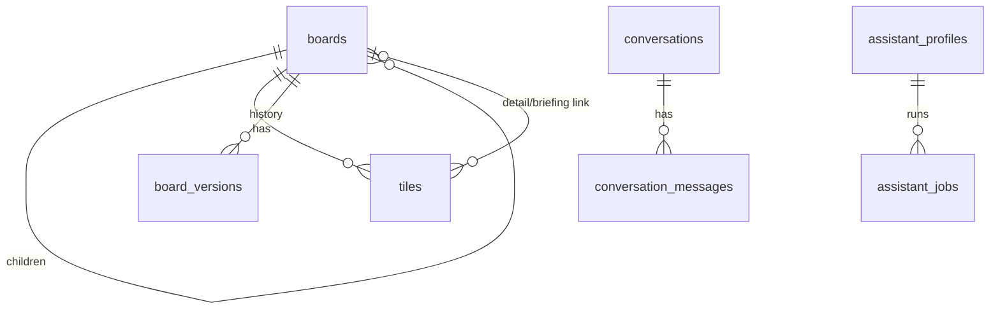

# 04 · Database, cache and queue, A to Z

> Series: [01 Features](01-FEATURES.md) · [02 Frontend](02-FRONTEND.md) · [03 Backend](03-BACKEND.md) · **04 Database** · [05 Docker](05-DOCKER.md) · [06 Deployment](06-DEPLOYMENT.md)

---

## 1. Topology
| Environment | Engine | Databases | Connection |
|---|---|---|---|
| Local (no Docker) | SQLite (WAL, foreign keys ON) | `identity.db`, `pulseboard.db` files | `sqlite+aiosqlite:///./…` |
| Docker | PostgreSQL 16-alpine | `pulseboard` (created by env), `identity` (created by `postgres/init.sql`) | `postgresql+asyncpg://pulseboard:…@postgres:5432/<db>` |
| Azure | PostgreSQL Flexible Server 16, B1ms, 32 GB, 7-day backups | `pulseboard`, `identity` | `postgresql+asyncpg://pbadmin:…@pb-pg-….postgres.database.azure.com:5432/<db>?ssl=require` (from Key Vault) |

**Database per service:**
- identity only touches `identity`, and the API only touches `pulseboard`.
- They're linked only by `user_id` (= the token's `sub`). There are no cross-database foreign keys.

---

## 2. `identity` database
### `users`
| Column | Type | Null | Default | Notes |
|---|---|---|---|---|
| `id` | varchar(36) | no | uuid4 | PK |
| `email` | varchar(254) | no | | **unique**, indexed, lower-cased |
| `display_name` | varchar(120) | no | | |
| `password_hash` | varchar(255) | no | | `scrypt$16384$8$1$<salt b64>$<hash b64>` |
| `role_cd` | varchar(16) | no | | `ADMIN`/`EDITOR`/`VIEWER`, indexed |
| `is_active` | boolean | no | true | |
| `last_login_at` | timestamptz | yes | | |
| `created_at`, `updated_at` | timestamptz | no | now() | `updated_at` on update |

### `refresh_tokens`
| Column | Type | Null | Notes |
|---|---|---|---|
| `id` | varchar(36) | no | PK |
| `user_id` | varchar(36) | no | FK → `users.id` **ON DELETE CASCADE**, indexed |
| `family_id` | varchar(36) | no | indexed; one per login session |
| `token_hash` | varchar(64) | no | **unique**; SHA-256 of the token |
| `expires_at` | timestamptz | no | now + 7 days |
| `revoked_at` | timestamptz | yes | set on rotate, logout, theft, or role change |
| `created_at` | timestamptz | no | |

**Typical queries:**
```sql
-- login
SELECT * FROM users WHERE email = $1;
-- refresh (rotate)
SELECT * FROM refresh_tokens WHERE token_hash = $1;
UPDATE refresh_tokens SET revoked_at = now() WHERE id = $1;
-- theft detected / logout / role change
UPDATE refresh_tokens SET revoked_at = now() WHERE family_id = $1 AND revoked_at IS NULL;
UPDATE refresh_tokens SET revoked_at = now() WHERE user_id = $1 AND revoked_at IS NULL;
```

---

## 3. `pulseboard` database
### `boards`
| Column | Type | Notes |
|---|---|---|
| `id` | varchar(36) PK | |
| `user_id` | varchar(64), indexed | owner (identity `sub`) |
| `parent_board_id` | FK → boards.id ON DELETE CASCADE, indexed | NULL for an overview |
| `kind_cd` | varchar(16) | `OVERVIEW` / `DETAIL` / `BRIEFING` |
| `slot_key` | varchar(128) | `overview`, `detail:<metric>`, `briefing:<metric>`; **unique with parent** |
| `title` | varchar(256) | |
| `origin_cd` | varchar(24) | `SETUP` / `DEFAULT_TEMPLATE` / `REVIEW` |
| `build_status_cd` | varchar(16) | `BUILDING` / `LIVE` / `FAILED` |
| `settings` | JSON | overview: team, areas, region, alert_count; briefing: summary, owners, sources, next_steps |
| `version` | int | +1 per publish |
| `claim_holder` | varchar(128) | `setup:<job>` / `review:<job>` |
| `claim_expires_at` | timestamptz | now + 120 s |
| `generation` | int | fencing token (+1 per claim) |
| `next_review_at` | timestamptz, indexed | now + 60 min after publish |
| `created_at`, `updated_at` | timestamptz | |

### `tiles`
| Column | Type | Notes |
|---|---|---|
| `id` | varchar(36) PK | |
| `board_id` | FK → boards ON DELETE CASCADE, indexed | |
| `position` | int | **unique with board_id** |
| `slot_key` | varchar(128) | `alert:<m>`, `stat:<m>`, `trend:<m>`, `series`, `regions`, `projection`, `now`, `outlook` |
| `title` | varchar(256) | |
| `visual_cd` | varchar(16) | `STAT` / `TREND` / `BREAKDOWN` / `NOTE` |
| `tier_cd` | varchar(16) | `ALERT` / `HEADLINE` / `CONTEXT` |
| `priority_cd` | varchar(16) | `LOW` / `MEDIUM` / `HIGH` |
| `follow_up_cd` | varchar(16) | `NONE` / `PENDING` / `SEEN` / `DONE` |
| `detail_board_id`, `briefing_board_id` | FK → boards ON DELETE SET NULL | alert links |
| `query_spec` | JSON | `{"metric":"sales.bookings","op":"stat","params":{"region":"EMEA"}}` |
| `presentation` | JSON | `{"unit":"USD","summary":"…"}` |

### `board_versions`
`id` PK · `board_id` FK cascade · `version` (**unique with board_id**) · `job_id` · `snapshot` JSON (the planned board) · `created_at`

### `metrics` (the catalog)
| Column | Type | Notes |
|---|---|---|
| `key` | varchar(128) PK | `area.name` |
| `area` | varchar(64), indexed | |
| `title` | varchar(256), indexed | |
| `unit` | varchar(32) | validated against `PB_UNITS` |
| `base`, `volatility` | float | mock-source parameters |
| `higher_is_better` | bool | |
| `owners`, `sources` | JSON arrays | |
| `enabled` | bool, indexed | |
| `created_at`, `updated_at` | timestamptz | |

**Initial catalog** (seeded only when the table is empty):

| Key | Unit | Better |
|---|---|---|
| `sales.bookings` | USD | higher |
| `sales.pipeline_coverage` | x | higher |
| `customers.churn_rate` | % | lower |
| `customers.nps` | pts | higher |
| `operations.delivery_lead_time` | days | lower |
| `operations.support_backlog` | tickets | lower |
| `engineering.availability` | % | higher |
| `engineering.change_failure_rate` | % | lower |
| `finance.cloud_spend` | USD | lower |

### Other tables
| Table | Columns |
|---|---|
| `user_preferences` | `id`, `user_id`, `origin_cd` (SETUP/REVIEW/USER), `scope_cd` (LAYOUT/WATCHLIST), `key`, `value` JSON; **unique (user_id, scope_cd, key)** |
| `assistant_profiles` | `key` PK (`SETUP_ASSISTANT`, `BOARD_REVIEWER`), `name`, `model`, `instructions`, `tools` JSON, `enabled` |
| `assistant_jobs` | `id`, `job_type_cd` (SETUP/REVIEW), `profile_key`, `user_id`, `board_id`, `status_cd` (RUNNING/SUCCEEDED/FAILED/SKIPPED), `error`, `enqueued_at`, `started_at`, `finished_at` |
| `conversations` | `id`, `user_id`, `purpose_cd` (SETUP), `status_cd` (OPEN/CLOSED), `state` JSON `{step}` |
| `conversation_messages` | `id`, `conversation_id` FK cascade, `author_cd` (user/assistant), `content`, `created_at` |

### ER diagram


---

## 4. Migrations
| Repo | Revision | Creates |
|---|---|---|
| identity | `0001_users_and_refresh_tokens` | `users`, `refresh_tokens` |
| api | `0001_initial_schema` | boards, board_versions, tiles, assistant_profiles, assistant_jobs, user_preferences, conversations, conversation_messages |
| api | `0002_metric_catalog` | `metrics` |

```bash
alembic upgrade head          # run automatically by startup.sh on every start
alembic downgrade -1          # roll back one step
# new migration after editing models (use a scratch SQLite DB):
PB_DATABASE_URL=sqlite+aiosqlite:///./_m.db alembic upgrade head && \
PB_DATABASE_URL=sqlite+aiosqlite:///./_m.db alembic revision --autogenerate -m "describe change"
```
- **Batch mode:** migrations are written with `render_as_batch=True`, so they also work on SQLite.
- **Local schema:** `PB_DB_AUTO_CREATE` / `ID_DB_AUTO_CREATE` (true locally) creates tables without Alembic.

---

## 5. Redis keyspace
| Key pattern | Value | TTL | Set by | Deleted by |
|---|---|---|---|---|
| `catalog:v1` | enabled metrics `{key: {...}}` | 300 s | `catalog.load_catalog` | metric write |
| `metrics:list:<q>\|<area>\|<enabled>\|<page>\|<size>\|<sort>\|<desc>` | page JSON | 60 s | `catalog.search` | metric write (prefix) |
| `board:<board_id>` | BoardOut JSON (never BUILDING) | 300 s | ownership check / GET board | publish (family), release |
| `tiles:<board_id>` | `[TileOut]` | 300 s | GET tiles | publish (family), follow-up |
| `tile:<tile_id>:<YYYYMMDDHH>` | query result | 300 s | tile-data (pipelined) | metric write (prefix `tile:`) |
| `boards:<user_id>:<q>\|<kind>\|<page>\|<size>` | page JSON | 60 s | GET /boards | publish for that user (prefix) |
| `login:fail:email:<email>` / `login:fail:ip:<ip>` | int | 900 s | identity login failure | successful login |

**Server settings:**
- **Docker:** `maxmemory 128mb`, `allkeys-lru`, no persistence.
- **Azure (optional):** Azure Managed Redis, `AllKeysLRU`, TLS on port 10000.

**Databases:** API uses `/0`, identity uses `/1`.

**Inspect:**
```bash
docker compose exec redis redis-cli --scan | cut -d: -f1 | sort | uniq -c
docker compose exec redis redis-cli -n 1 --scan --pattern 'login:fail:*'
```

---

## 6. Queue
| Item | SQS (local/Docker) | Azure Storage Queue |
|---|---|---|
| Name | `board-reviews` | `board-reviews` |
| Endpoint | moto `http://localhost:5000` / `http://sqs:5000` | `https://pbq….queue.core.windows.net` |
| Auth | dummy keys (moto) | managed identity (Storage Queue Data Contributor), **shared keys disabled** |
| Message | `{"boardId","userId","enqueuedAt"}` | same |
| Visibility timeout | 300 s | 300 s |
| Batch send | `send_message_batch` ×10 | sequential (no batch API) |
| Poison | dropped after 5 attempts (`ApproximateReceiveCount`) | dropped after 5 (`dequeue_count`) |

---

## 7. Data lifecycle and integrity
| Rule | Enforced by |
|---|---|
| A board's tiles are replaced atomically on publish | one transaction (DELETE tiles + INSERT) |
| Removed alerts remove their detail/briefing boards | DELETE of boards no longer in the plan (cascade to tiles and versions) |
| Follow-ups survive republish | matched by `(board_id, slot_key)` before replacement |
| Positions unique per board | `UNIQUE (board_id, position)` |
| One overview per user | `find_overview` + claim; children unique by `(parent_board_id, slot_key)` |
| Account deletion cleans tokens | FK cascade `refresh_tokens.user_id` |

---

## 8. Backup and restore
| Environment | How |
|---|---|
| Azure | Flexible Server automated backups, 7-day retention, point-in-time restore in the portal or with `az postgres flexible-server restore` |
| Docker | `docker compose exec postgres pg_dump -U pulseboard pulseboard > pulseboard.sql` (and `-d identity`) |
| Restore (Docker) | `docker compose exec -T postgres psql -U pulseboard pulseboard < pulseboard.sql` |
