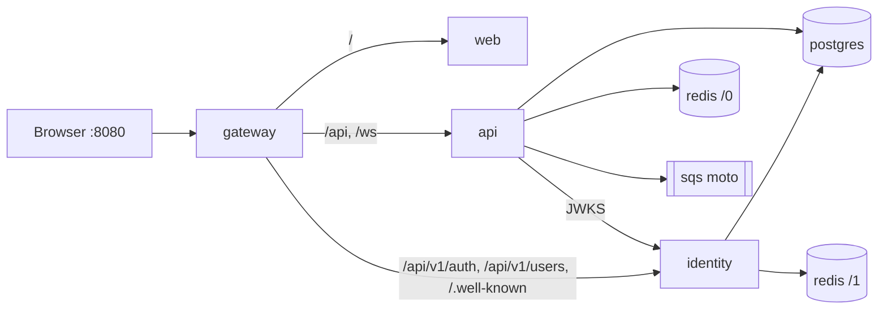

# 05 · Docker, A to Z

> Series: [01 Features](01-FEATURES.md) · [02 Frontend](02-FRONTEND.md) · [03 Backend](03-BACKEND.md) · [04 Database](04-DATABASE.md) · **05 Docker** · [06 Deployment](06-DEPLOYMENT.md)

---

## 1. Images
| Image | Dockerfile | Stages | Runtime user | Port | Healthcheck |
|---|---|---|---|---|---|
| `pulseboard-identity` | `pulseboard-identity/Dockerfile` | `python:3.12-slim` build (venv + requirements) → slim runtime | `app` (uid 10001) | 8000 | `GET /healthz` |
| `pulseboard-api` | `pulseboard-api/Dockerfile` | same pattern | `app` (uid 10001) | 8000 | `GET /healthz` |
| `pulseboard-web` | `pulseboard-web/Dockerfile` | `node:20-alpine` (`npm ci`, `npm run build`) → `nginxinc/nginx-unprivileged:1.27-alpine` | 101 | 8080 | `wget /` |
| gateway | stock `nginx:1.27-alpine` + mounted `gateway/nginx.conf` | — | nginx | 8080 | `GET /gateway/health` |

### 1.1 Python service Dockerfile (both services)
```dockerfile
FROM python:3.12-slim AS build
ENV PIP_NO_CACHE_DIR=1 PIP_DISABLE_PIP_VERSION_CHECK=1
WORKDIR /build
COPY requirements.txt .
RUN python -m venv /venv && /venv/bin/pip install -r requirements.txt

FROM python:3.12-slim
ENV PYTHONDONTWRITEBYTECODE=1 PYTHONUNBUFFERED=1 PATH="/venv/bin:$PATH" PORT=8000
RUN useradd --system --uid 10001 app
WORKDIR /app
COPY --from=build /venv /venv
COPY app ./app
COPY migrations ./migrations
COPY alembic.ini startup.sh ./
# identity only: RUN mkdir -p /app/.keys && chown app /app/.keys
USER app
EXPOSE 8000
HEALTHCHECK --interval=15s --timeout=3s --start-period=20s --retries=5 CMD python -c "…/healthz…"
CMD ["bash", "startup.sh"]
```

`startup.sh` (both services):
```bash
python -m alembic upgrade head
exec gunicorn app.main:app --worker-class uvicorn.workers.UvicornWorker \
  --workers "${WEB_CONCURRENCY:-2}" --bind "0.0.0.0:${PORT:-8000}" \
  --timeout 120 --graceful-timeout 30 --keep-alive 75 --access-logfile - --forwarded-allow-ips="*"
```

### 1.2 Web Dockerfile
1. `npm ci`, then `npm run build`, which outputs `dist/pulseboard/browser`.
2. The bundle is copied into the nginx-unprivileged image.
3. `docker/write-config.sh` is installed as `/docker-entrypoint.d/40-write-config.sh`. At start it writes `/usr/share/nginx/html/config.json` from `API_URL`, `AUTH_URL` and `WS_URL`.
4. `docker/nginx.conf` provides:
   - the SPA fallback (`try_files … /index.html`)
   - `config.json` served `no-store`
   - hashed assets cached for 1 year (`immutable`)
   - gzip and security headers

### 1.3 `.dockerignore`
- **Python:** `.venv`, `.git`, `.github`, caches, `*.db*`, `.env`, `tests`, `docs`, `infra`, `scripts`, plus `.keys` for identity.
- **Web:** `node_modules`, `dist`, `.angular`, `.git`.

---

## 2. `docker-compose.yml` (in `pulseboard-platform`)
| Service | Image / build | Depends on (condition) | Env highlights | Ports |
|---|---|---|---|---|
| `postgres` | `postgres:16-alpine` | — | `POSTGRES_DB=pulseboard`, user/password; mounts `postgres/init.sql` (creates `identity`) | 5432 |
| `redis` | `redis:7-alpine` | — | `--maxmemory 128mb --maxmemory-policy allkeys-lru --save ""` | internal |
| `sqs` | `motoserver/moto:5.0.28` | — | mock AWS | internal |
| `identity` | `build: ../pulseboard-identity` | postgres, redis (healthy) | `ID_DATABASE_URL=…/identity`, `ID_REDIS_URL=redis://redis:6379/1`, bootstrap admin; volume `idkeys:/app/.keys` | internal |
| `api` | `build: ../pulseboard-api` | postgres, redis, identity (healthy), sqs (started) | `PB_JWKS_URL=http://identity:8000/.well-known/jwks.json`, `PB_CACHE_BACKEND=redis`, `PB_QUEUE_BACKEND=sqs`, `PB_AWS_ENDPOINT_URL=http://sqs:5000`, `PB_CORS_ORIGINS=[]` | 8000 (ops) |
| `web` | `build: ../pulseboard-web` | — | `API_URL=""`, `AUTH_URL=""`, `WS_URL=ws://localhost:8080/ws/events` | internal |
| `gateway` | `nginx:1.27-alpine` | identity, api (healthy), web | mounts `gateway/nginx.conf` | **8080** |

**Volumes:**
- `pgdata`: Postgres data.
- `idkeys`: the identity dev signing key, which survives restarts.

**Overridable from the shell or a `.env` next to the compose file:**
- `POSTGRES_PASSWORD` (default `pulseboard-local`)
- `ADMIN_EMAIL` (default `admin@example.com`)
- `ADMIN_PASSWORD` (default `Admin-Pulseboard-2026`)



**Start order (health-gated):**
1. postgres and redis report healthy.
2. identity runs its migrations, creates the bootstrap admin, and reports healthy.
3. api runs its migrations, seeds the catalog, and reports healthy.
4. gateway starts.

---

## 3. Gateway config (`gateway/nginx.conf`), line by line
| Directive | Purpose |
|---|---|
| `limit_req_zone … zone=auth rate=10r/s` / `zone=api rate=50r/s` | per-IP rate limits |
| `map $http_upgrade $connection_upgrade` | WebSocket upgrade header |
| `upstream identity/api/web … keepalive` | pooled upstream connections |
| `proxy_set_header X-Request-ID $request_id` | tracing id for every request |
| `proxy_set_header X-Forwarded-For` | real client IP (used by login throttling) |
| `location ~ ^/(internal\|docs\|redoc\|openapi\.json) { return 404; }` | block internal and dev endpoints |
| `location /api/v1/auth/` → identity (`limit_req zone=auth burst=20`) | sign-in endpoints |
| `location /api/v1/users`, `/.well-known/` → identity | admin users, JWKS |
| `location /api/` → api, `proxy_buffering off`, `proxy_read_timeout 300s` | REST + **SSE** |
| `location /ws/` → api, Upgrade headers, 1 h timeout | **WebSocket** |
| `location = /gateway/health` | gateway health |
| `location /` → web | the SPA |

---

## 4. Commands
```bash
cd pulseboard-platform
docker compose up --build -d             # build + start everything
docker compose ps                        # status / health
docker compose logs -f api identity      # follow logs
docker compose up --build -d api         # rebuild one service after a code change
docker compose restart gateway           # reload nginx.conf
docker compose exec postgres psql -U pulseboard -d identity -c "select email, role_cd from users"
docker compose exec redis redis-cli --scan | head
docker compose down                      # stop
docker compose down -v                   # stop + delete data and the dev signing key
```

**End-to-end check against Docker:**
```bash
python scripts/e2e_check.py --name docker --auth http://localhost:8080 --api http://localhost:8080 \
  --ws ws://localhost:8080/ws/events --admin-email admin@example.com --admin-password Admin-Pulseboard-2026
```
Result at capture time: **17/17 checks passed** (see [EVIDENCE.md](EVIDENCE.md)).

---

## 5. Troubleshooting Docker
| Symptom | Fix |
|---|---|
| `port is already allocated` | Stop local servers on 8000, 8080, 5432, or change the host ports in compose |
| `identity` unhealthy | `docker compose logs identity`: usually Postgres not ready yet, or the `identity` DB missing. Recreate with `docker compose down -v`. |
| API returns 401 everywhere | `docker compose logs api \| grep JWKS`; check that `PB_JWKS_URL` resolves (`identity:8000`) |
| Web shows old code | `docker compose up --build -d web` (images are rebuilt only when asked) |
| Sign-in "Cannot reach the server" | Use the gateway URL `http://localhost:8080`, not the web container |
| Disk space | `docker system prune` (removes unused images and build cache) |
