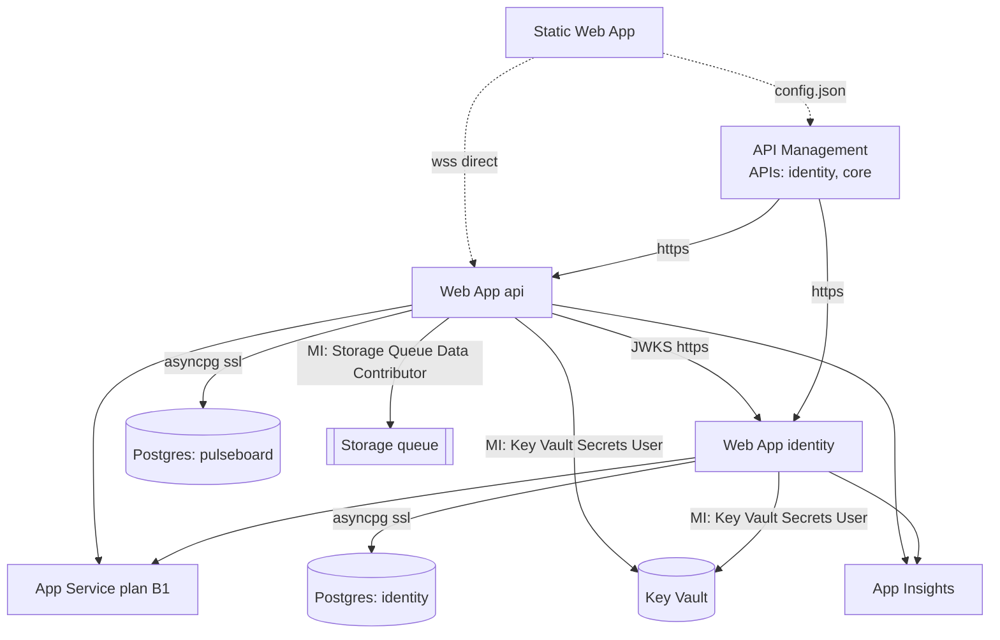
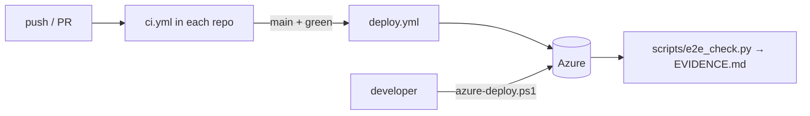

# 06 · Deployment, A to Z (Azure + CI/CD)

> Series: [01 Features](01-FEATURES.md) · [02 Frontend](02-FRONTEND.md) · [03 Backend](03-BACKEND.md) · [04 Database](04-DATABASE.md) · [05 Docker](05-DOCKER.md) · **06 Deployment**

---

## 1. Live environment
| Component | Azure resource | URL |
|---|---|---|
| Website | Static Web App `pb-web-ktuth67ohzdbe` (Free, eastasia) | https://black-mud-02ef90500.6.azurestaticapps.net |
| Gateway | API Management `pb-gw-ktuth67ohzdbe` (Consumption) | https://pb-gw-ktuth67ohzdbe.azure-api.net (`/identity`, `/core`) |
| Identity | Web App `pb-id-ktuth67ohzdbe` (Linux, Python 3.12) | https://pb-id-ktuth67ohzdbe.azurewebsites.net |
| API | Web App `pb-api-ktuth67ohzdbe` (Linux, Python 3.12, WebSockets on) | https://pb-api-ktuth67ohzdbe.azurewebsites.net |
| Plan | App Service plan `pb-plan-ktuth67ohzdbe` (B1, hosts **both** apps) | — |
| Database | Postgres Flexible `pb-pg-ktuth67ohzdbe` (B1ms, v16, DBs `pulseboard` + `identity`) | private hostname |
| Secrets | Key Vault `pb-kv-ktuth67ohzdbe` (RBAC) | — |
| Queue | Storage `pbqktuth67ohzdbe`, queue `board-reviews` (shared keys disabled) | — |
| Monitoring | App Insights `pb-insights-…`, Log Analytics `pb-logs-…` (0.15 GB/day cap) | — |
| Alerting | Action group `pb-oncall`, metric alert `pb-api-5xx`, budget `pb-monthly-budget` | email |

- **Resource group:** `rg-pulseboard`.
- **Region:** Central India (the Static Web App is in East Asia, because SWA is only offered in some regions).
- The resource suffix is `uniqueString(resourceGroup().id)`, so it stays the same on every deploy.

---

## 2. Infrastructure as code (`infra/main.bicep`)
| Parameter | Default | Notes |
|---|---|---|
| `location` | resource group location | |
| `appServiceSku` | `B1` | S1/P0v3 for autoscale and slots |
| `postgresAdminLogin` / `postgresAdminPassword` | `pbadmin` / secure | |
| `serviceKey` | secure | `/internal` protection |
| `identityJwtKeyB64` | secure | RSA private key (base64 PEM) |
| `adminPassword` | secure | bootstrap admin |
| `ownerEmail` | required | admin login + alert emails |
| `webLocation` | `eastasia` | Static Web Apps regions only |
| `monthlyBudget` / `deployBudget` | 2000 / true | budget alert |
| `deployRedis` | false | Azure Managed Redis (extra cost) |

### Resources and wiring


### Key Vault secrets → app settings
| Secret | Used as |
|---|---|
| `database-url` | `PB_DATABASE_URL` (api) |
| `identity-database-url` | `ID_DATABASE_URL` (identity) |
| `identity-jwt-key` | `ID_JWT_PRIVATE_KEY_B64` (identity) |
| `identity-admin-password` | `ID_BOOTSTRAP_ADMIN_PASSWORD` (identity) |
| `service-key` | `PB_SERVICE_KEY` (api) |
| `redis-url` (only with `deployRedis`) | `PB_REDIS_URL` (api) |

Each is referenced as `@Microsoft.KeyVault(SecretUri=…)`; the apps read them with their **system-assigned managed identity**.

### App settings (non-secret)
| App | Settings |
|---|---|
| identity | `ID_ENVIRONMENT=production`, `ID_DB_AUTO_CREATE=false`, `ID_BOOTSTRAP_ADMIN_EMAIL=<ownerEmail>`, `ID_CORS_ORIGINS=[]`, `WEB_CONCURRENCY=2`, `SCM_DO_BUILD_DURING_DEPLOYMENT=true`, App Insights connection string |
| api | `PB_ENVIRONMENT=production`, `PB_JWKS_URL=https://<identity>/.well-known/jwks.json`, `PB_CACHE_BACKEND=none\|redis`, `PB_QUEUE_BACKEND=azure`, `PB_AZURE_QUEUE_ACCOUNT_URL`, `PB_REVIEW_QUEUE_NAME`, `PB_CORS_ORIGINS=[]`, `PB_DB_AUTO_CREATE=false`, `WEB_CONCURRENCY=2` |

**Site config (both apps):**
- `PYTHON|3.12`, startup `bash startup.sh`
- Always On, HTTPS only, TLS 1.2, FTPS disabled, HTTP/2
- health check path `/healthz`
- api only: WebSockets enabled

### API Management configuration
| API | Path | Backend | Operations |
|---|---|---|---|
| `identity` | `/identity` | `https://pb-id-….azurewebsites.net` | GET/POST/PUT/PATCH/DELETE × `/api/v1/auth/*`, `/api/v1/users`, `/api/v1/users/*`, `/.well-known/*` |
| `core` | `/core` | `https://pb-api-….azurewebsites.net` | GET/POST/PUT/PATCH/DELETE × `/api/v1/*` |

**Policy on both APIs:**
1. `<cors>` allows origins: SWA and `http://localhost:5173`; methods: GET, POST, PUT, PATCH, DELETE, OPTIONS; headers: Authorization, Content-Type, X-Request-ID.
2. `set-header X-Forwarded-For = context.Request.IpAddress`.
3. `forward-request timeout=120 buffer-response=false`, so SSE streams.

`subscriptionRequired=false`: the browser sends no APIM key, and the services verify the bearer token themselves.

---

## 3. One-command deploy (`scripts/azure-deploy.ps1`)
```powershell
az login --tenant <tenant-id>
cd pulseboard-platform
./scripts/azure-deploy.ps1 -OwnerEmail you@example.com              # full
./scripts/azure-deploy.ps1 -OwnerEmail you@example.com -SkipInfra   # code only
./scripts/azure-deploy.ps1 -OwnerEmail you@example.com -SkipWeb     # no website
./scripts/azure-deploy.ps1 -OwnerEmail you@example.com -DeployRedis # add Redis
```

| Step | What happens | Failure handling |
|---|---|---|
| 1 Secrets | Generates once into `infra/secrets.local.json` (git-ignored): Postgres password, service key, admin password, RSA 2048 key | reused on later runs |
| 2 Resource group | `az group create rg-pulseboard` | |
| 3 Wake Postgres | starts the server if `Stopped` | |
| 4 Bicep | `az deployment group create --name pulseboard-infra` | first run ~15 min (APIM is slowest) |
| 5 Outputs | reads app names, URLs, gateway URL | |
| 6 Identity + API code | `tar` zip (forward slashes) of `app migrations alembic.ini requirements.txt startup.sh`; `az webapp deploy --async true` | retries **409 DeploymentInProgress** every 30 s (×20) |
| 7 Readiness | waits 60 s, then polls `/readyz` of both apps (up to ~12 min) | throws with the failing URL |
| 8 Website | `npm run build`; writes `config.json` (gateway `/core`, `/identity`, direct WSS); SWA CLI upload | |
| 9 Smoke test | admin login **through the gateway**, then `GET /core/api/v1/meta` with the token | throws if either fails |

**On the App Service host,** Oryx creates a virtualenv and runs `pip install -r requirements.txt`. Then `startup.sh` runs the migrations and starts gunicorn.

---

## 4. Pause, resume, remove
| Action | Command | Effect |
|---|---|---|
| Pause billing | `./scripts/azure-stop.ps1` | stops both apps, Always On off, plan → **F1** (free), stops Postgres |
| Resume | `./scripts/azure-deploy.ps1 -OwnerEmail … -SkipInfra` (or full) | plan back to B1 (Bicep), starts everything, redeploys |
| Remove all | `az group delete -n rg-pulseboard` | deletes every resource (Key Vault enters soft-delete for 7 days) |

Azure automatically restarts a stopped Postgres after 7 days.

---

## 5. Cost (free trial friendly)
| Resource | ≈ per day | Notes |
|---|---|---|
| App Service B1 (both apps) | ₹35 | the main cost |
| Postgres B1ms | ₹0 | 750 free hours/month for 12 months |
| API Management Consumption | ₹0 | first 1M calls/month free |
| Static Web Apps Free | ₹0 | |
| Key Vault, Storage Queue | ≈₹0 | per-operation pennies |
| App Insights / Log Analytics | ₹0 | under the free ingestion cap |
| Azure Managed Redis (optional) | ₹40–50 | only with `-DeployRedis` |

**Guardrails:**
- a monthly budget (₹2,000) emails at 50% actual and 100% forecast
- a 5xx alert emails when the API has more than 10 errors in 5 minutes

---

## 6. CI/CD (GitHub Actions)
| Repo | Workflow | Trigger | Jobs |
|---|---|---|---|
| identity | `ci.yml` | push, PR | `test` (ruff, pytest) → `image` (build, boot on Postgres, JWKS + admin login) |
| api | `ci.yml` | push, PR | `test` (ruff, pytest) → `integration` (image + Postgres + Redis + moto, minted token, `demo.py`, cache up) |
| api | `deploy.yml` | CI success on `main`, manual | OIDC `azure/login` → zip → `azure/webapps-deploy` → `/readyz` smoke |
| web | `ci.yml` | push, PR | npm ci → app build → lib build → docker build |
| web | `deploy.yml` | push to `main`, manual | build → write `config.json` from vars → `Azure/static-web-apps-deploy` |
| platform | `ci.yml` | push, PR | `az bicep build` · `docker compose config` · `nginx -t` |

**To enable the deploy workflows:**
1. Create an Entra app registration with a **federated credential** for each repo (subject `repo:<owner>/<repo>:environment:production`).
2. Grant it **Contributor** on `rg-pulseboard`.
3. API repo: secrets `AZURE_CLIENT_ID`, `AZURE_TENANT_ID`, `AZURE_SUBSCRIPTION_ID`; variable `AZURE_WEBAPP_NAME=pb-api-ktuth67ohzdbe`.
4. Web repo: secret `AZURE_STATIC_WEB_APPS_API_TOKEN` (`az staticwebapp secrets list …`); variables `API_URL`, `AUTH_URL`, `WS_URL`.

Until these are set, the deploy jobs **skip** themselves.



---

## 7. Verifying a deployment
```bash
curl https://pb-id-ktuth67ohzdbe.azurewebsites.net/readyz      # {"status":"ok","database":"up"}
curl https://pb-api-ktuth67ohzdbe.azurewebsites.net/readyz     # {"status":"ok","database":"up","cache":"off"}
curl https://pb-gw-ktuth67ohzdbe.azure-api.net/identity/.well-known/jwks.json
curl https://black-mud-02ef90500.6.azurestaticapps.net/config.json
python scripts/e2e_check.py --name azure --auth https://pb-gw-ktuth67ohzdbe.azure-api.net/identity \
  --api https://pb-gw-ktuth67ohzdbe.azure-api.net/core --ws wss://pb-api-ktuth67ohzdbe.azurewebsites.net/ws/events \
  --admin-email <owner> --admin-password <adminPassword>
```
Last run: **17/17 passed** (see [EVIDENCE.md](EVIDENCE.md)).

---

## 8. Deployment troubleshooting (all seen and fixed during the build)
| Symptom | Cause | Fix |
|---|---|---|
| `AADSTS530035` at `az login --use-device-code` | Security defaults block device code | `az login --tenant <id>` (browser flow) |
| Postgres "restricted in this region" | Free-trial region limits | Use Central India |
| `Compress-Archive` zip won't start on Linux | PowerShell 5.1 writes backslash paths | Package with `tar -a -c -f` |
| Kudu 504 GatewayTimeout on deploy | pip install outlasts the synchronous call | `--async true` + `/readyz` polling |
| 409 DeploymentInProgress | Previous deploy still building | Script retries every 30 s |
| App crash: duplicate key `assistant_profiles_pkey` | Two gunicorn workers seeding at once | Race-safe seeding (IntegrityError → rollback) |
| App crash: "must be set in production" | New app settings with old code (or the reverse) | Deploy infra and code together (script order) |
| 503 right after deploy | Startup in progress | Wait; `az webapp log download`, read `*_default_docker.log` |
| `npm ci` EPERM | Running dev server locks `node_modules` | Script reuses an existing install |
