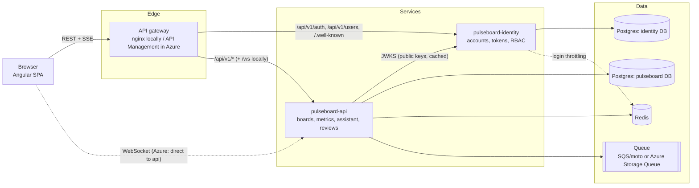
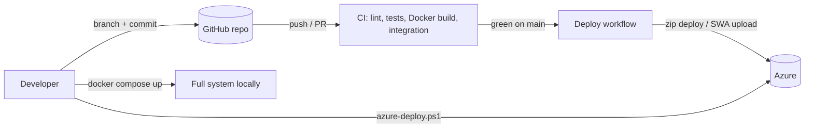

# Pulseboard microservices, API gateway and end-to-end workflow

This document covers the services, how a request travels, how authentication and RBAC work, and how code gets from a developer's laptop to Azure.

---

## 1. System at a glance



| Repo | Role | Owns |
|---|---|---|
| `pulseboard-identity` | Identity provider | `users`, `refresh_tokens` (identity DB). RS256 signing key. JWKS. Role → permission map. |
| `pulseboard-api` | Domain service | boards, tiles, versions, metrics catalog, preferences, conversations, jobs (pulseboard DB). Redis cache. Review queue. |
| `pulseboard-web` | Angular 17 monorepo (`pulseboard` app + `data-access` lib) | UI only. Endpoints come from runtime `/config.json`. |
| `pulseboard-platform` | Glue | Gateway config, `docker-compose.yml`, Azure Bicep, deploy and stop scripts, these docs |

**Database per service:** identity and api never read each other's tables. They share one Postgres **server**, which costs nothing extra, but each has its own **database**.

---

## 2. Authentication and authorization

### 2.1 Sign-in and token flow
```mermaid
sequenceDiagram
    participant B as Browser
    participant G as Gateway
    participant I as Identity
    participant A as API
    B->>G: POST /api/v1/auth/login {email, password}
    G->>I: forward (X-Forwarded-For = client IP)
    I->>I: rate-limit (email + IP), scrypt verify
    I-->>B: access token (RS256, 15 min) + refresh token (7 days, opaque)
    B->>G: GET /api/v1/boards  Authorization: Bearer <access>
    G->>A: forward
    A->>I: GET /.well-known/jwks.json (only on first use or an unknown key id; cached 5 min)
    A->>A: verify signature, iss, aud, exp, typ; check perms claim
    A-->>B: 200, or 401 / 403
    Note over B: access token expires
    B->>G: POST /api/v1/auth/refresh {refresh_token}
    I->>I: revoke presented token, issue new pair in same family
    I-->>B: new access + refresh
```

**Access token claims:**
```json
{"sub": "<user id>", "email": "...", "role": "EDITOR", "perms": ["boards:read", "metrics:write", "…"],
 "iss": "pulseboard-identity", "aud": "pulseboard", "typ": "access", "exp": …}
```

### 2.2 RBAC
| Permission | VIEWER | EDITOR | ADMIN | Enforced by |
|---|:-:|:-:|:-:|---|
| `boards:read` (boards, tiles, tile data, meta) | ✓ | ✓ | ✓ | api |
| `boards:follow_up` | ✓ | ✓ | ✓ | api |
| `setup:run` (assistant) | ✓ | ✓ | ✓ | api |
| `jobs:read` | ✓ | ✓ | ✓ | api |
| `metrics:read` | ✓ | ✓ | ✓ | api |
| `metrics:write` (create, update, delete) | | ✓ | ✓ | api |
| `users:read`, `users:write` | | | ✓ | identity |

- **Where the roles live:** the role → permission map exists in exactly one place, `pulseboard-identity/app/security.py`. Other services only read the signed `perms` claim, so adding a permission to a role needs no API change.
- **Ownership on top of RBAC:** a board is visible only to its `sub`. Other users get 404, not 403, so its existence isn't revealed.
- **The UI mirrors permissions:** route guards, a hidden Users menu, a read-only metric catalog for VIEWER. The services enforce them regardless.

### 2.3 Security properties
| Threat | Mitigation |
|---|---|
| Password theft from DB | scrypt (n=2¹⁴, r=8, p=1) with a per-user salt |
| User enumeration | Same message and same work (dummy hash) for unknown email and wrong password |
| Brute force | 5 failures per email **and** per IP in 15 min → 429 (Redis-backed, shared by instances); gateway rate limits `/auth` |
| Stolen refresh token | Rotation on every use. Replaying an old token revokes the whole family. Logout revokes the family. |
| Stale privileges | Role change or deactivation revokes refresh tokens, so it takes effect within 15 minutes |
| Lockout of the system | The last active admin can't be demoted or deactivated |
| Forged tokens | RS256. Only identity holds the private key (Key Vault in Azure). Others verify with the public JWKS. `iss`, `aud`, `typ` and `exp` are all checked. |
| Key rotation | JWKS carries `kid`. The API refetches JWKS on an unknown `kid`, so no redeploy is needed. |
| Internal endpoints | `/internal/*` and `/docs` are not routed by either gateway. Service-to-service calls use `X-Service-Key`. |

---

## 3. API gateway

| Concern | Local / Docker (nginx, `gateway/nginx.conf`) | Azure (API Management, Consumption) |
|---|---|---|
| Base URL for the browser | same origin `http://localhost:8080` | `https://pb-gw-…azure-api.net/identity` and `/core` |
| Routing | `/api/v1/auth`, `/api/v1/users`, `/.well-known` → identity; `/api/*`, `/ws/*` → api; `/` → web | API `identity` → identity app; API `core` (`/api/v1/*`) → api app |
| Blocked | `/internal`, `/docs`, `/openapi.json` (404) | Not defined as operations, so unreachable |
| CORS | not needed (same origin) | `cors` policy at the edge; the services have CORS off |
| SSE | `proxy_buffering off` | `forward-request buffer-response="false"` |
| WebSocket | proxied (`/ws/`) | Consumption tier has no WebSocket support, so the browser connects to the api app directly |
| Rate limiting | `limit_req`: 10 r/s auth, 50 r/s API per IP | Identity throttling (above). Paid tiers add `rate-limit-by-key`. |
| Client IP | `X-Forwarded-For` | `set-header X-Forwarded-For` from `context.Request.IpAddress` |
| Cost | free | first 1M calls per month free |

The browser only ever knows three URLs, all from `/config.json`: `apiUrl`, `authUrl`, `wsUrl`.
- Locally behind nginx they're `""`, `""` and `ws://localhost:8080/ws/events`.
- With `ng serve`, the dev proxy plays the gateway's part (`projects/pulseboard/proxy.conf.json`).

---

## 4. Reliability and scale

| Area | How |
|---|---|
| Stateless services | All state is in Postgres, Redis or the queue. Any instance serves any request. |
| Horizontal scale | gunicorn runs 2 workers per app. Raise the App Service plan to S1/P0v3 for autoscale; nothing in the code changes. |
| Cross-instance realtime | Postgres `LISTEN/NOTIFY` relays `board.published` to every API instance |
| Concurrency safety | Board claims with generation fencing. `SKIP LOCKED` scheduler. Atomic signing-key creation (dev). Race-safe seeding. |
| Cache | Redis cache-aside with targeted invalidation. Falls back to the DB if Redis is down (see `pulseboard-api/docs/CACHING_AND_PERFORMANCE.md`). |
| Queue | At-least-once delivery, poison messages dropped after 5 attempts, batch sends |
| Health | `/healthz` (liveness) and `/readyz` (DB, plus cache state) on both services. App Service health checks restart bad instances. The gateway has `/gateway/health`. |
| Migrations | Alembic per service, run on every start (`startup.sh`). Additive changes deploy with no downtime. |
| Observability | JSON logs with `X-Request-ID` (the gateway sets it, the services propagate it). Application Insights. 5xx alert. Budget alert. |
| Failure isolation | Identity down: already-issued tokens keep working until they expire (JWKS cached). API down: sign-in still works. |

---

## 5. Cost (Azure, Central India, free-trial friendly)

| Resource | Tier | Approx. cost |
|---|---|---|
| App Service plan (hosts **identity and api**) | B1 | ~₹35/day; one plan for both services |
| PostgreSQL Flexible (two databases) | B1ms, 32 GB | free for 12 months (750 h/month) |
| API Management | Consumption | first 1M calls/month free |
| Static Web Apps | Free | ₹0 |
| Storage Queue, Key Vault | Standard | ~₹0 |
| App Insights + Log Analytics | 0.15 GB/day cap | free allowance |
| Azure Managed Redis | optional (`-DeployRedis`) | ~₹40–50/day; off by default (`PB_CACHE_BACKEND=none`) |

Pause everything with `scripts/azure-stop.ps1` (plan → F1, apps and Postgres stopped).

---

## 6. End-to-end workflow



### 6.1 Develop
1. Check out all four repos side by side.
2. Choose how to run it:
   - **Fastest, single service:** run it with `uvicorn` (identity on :8100, api on :8000), then `npm start` in web. The dev proxy routes `/api/v1/auth` to identity and `/api` and `/ws` to the api.
   - **Whole system:** `cd pulseboard-platform && docker compose up --build -d`, then open http://localhost:8080 and sign in as `admin@example.com` / `Admin-Pulseboard-2026`.
3. Write tests next to the change. Each repo runs `pytest`/`ruff` or `npm run build` locally.

### 6.2 Continuous integration (every push and pull request)
| Repo | Jobs |
|---|---|
| identity | ruff + pytest. Docker image boot against Postgres: JWKS served, admin login works. |
| api | ruff + pytest (RBAC, cache, N+1 guards). Image against Postgres, Redis and moto with an identity-style token, running `demo.py` end to end. |
| web | npm build of the app and the library, Docker build |
| platform | `az bicep build`, `docker compose config`, `nginx -t` on the gateway |

### 6.3 Deploy
- **Scripted, all at once:** `pulseboard-platform/scripts/azure-deploy.ps1 -OwnerEmail you@example.com`. It provisions or updates the infrastructure, wakes paused services, deploys identity and api (async zip, then waits for `/readyz`), builds the web app with a `config.json` pointing at the gateway, and finishes with a smoke test: admin login through the gateway and an authorized API call.
- **Per repo on merge to `main`:** each `deploy.yml` deploys its own service once the Azure secrets and variables are configured. See `pulseboard-api/docs/RUNBOOK.md` §4.

### 6.4 Operate
| Task | Command |
|---|---|
| Pause billing | `scripts/azure-stop.ps1` |
| Resume | `scripts/azure-deploy.ps1 -OwnerEmail … -SkipInfra` |
| Logs | `az webapp log tail -g rg-pulseboard -n <app>` |
| Promote a user | Users page (admin), or `PATCH /api/v1/users/{id}` |
| Rotate signing key | Put a new key in `infra/secrets.local.json` (`identityJwtKeyB64`) and redeploy. Existing sessions end at the next refresh. |
| Remove everything | `az group delete -n rg-pulseboard` |

---

## 7. Configuration reference

| Service | Prefix | Key settings |
|---|---|---|
| identity | `ID_` | `DATABASE_URL`, `JWT_PRIVATE_KEY_B64`, `ACCESS_TOKEN_MINUTES`, `REFRESH_TOKEN_DAYS`, `ALLOW_SIGNUP`, `SIGNUP_ROLE`, `BOOTSTRAP_ADMIN_EMAIL`/`PASSWORD`, `REDIS_URL`, `LOGIN_MAX_ATTEMPTS` |
| api | `PB_` | `DATABASE_URL`, `JWKS_URL` (or `JWT_PUBLIC_KEY_B64`), `CACHE_BACKEND`, `REDIS_URL`, `QUEUE_BACKEND`, `REGIONS`, `UNITS`, `PAGE_SIZES`, `SERVICE_KEY` |
| web | `/config.json` | `apiUrl`, `authUrl`, `wsUrl` (Docker: `API_URL`, `AUTH_URL`, `WS_URL` env) |

Both services refuse to start in production with default secrets or a missing signing or verification key.
