# Pulseboard: Full System Architecture

> **Current architecture (version 3):** Pulseboard is now four repos: `pulseboard-identity` (accounts, RS256 tokens, JWKS, RBAC), `pulseboard-api`, `pulseboard-web` and `pulseboard-platform` (API gateway, Compose, Azure Bicep, deploy scripts).
> - **Sign-in:** the demo token endpoint is gone. Users register or sign in with email and password through the gateway, and the API verifies RS256 tokens via JWKS (no shared HS256 secret).
> - **Where to read more:** [MICROSERVICES.md](MICROSERVICES.md) for services, gateway, auth/RBAC and workflow; [RUNBOOK.md](https://github.com/Amarnath123122/pulseboard-api/blob/main/docs/RUNBOOK.md) for commands.
> - **Older sections:** where they mention `/auth/dev-token`, `PB_JWT_SECRET`/HS256, or Compose and Azure scripts inside `pulseboard-api`, read them as superseded by the above.


> Frontend · Backend · Database · Queue · Azure · CI/CD · Security · Failure modes
> Every section answers **what, why, how, where, when, who**, plus **what if / what else / where else**.

Diagrams are **Mermaid**. They render in VS Code (Markdown Preview Mermaid extension), GitHub and most MD viewers.

---

## Table of contents
1. [The product in one minute](#1-the-product-in-one-minute)
2. [The big picture (C4: context → containers → components)](#2-the-big-picture)
3. [Repository map: where everything lives](#3-repository-map)
4. [Frontend (Angular 17) in depth](#4-frontend-angular-17)
5. [Backend (FastAPI) in depth](#5-backend-fastapi)
6. [Database in depth](#6-database)
7. [Queue and background workers](#7-queue-and-background-workers)
8. [Realtime: SSE, WebSocket, pg_notify](#8-realtime)
9. [Sequence diagrams for every flow](#9-sequence-diagrams)
10. [State machines](#10-state-machines)
11. [Azure deployment in depth](#11-azure-deployment)
12. [CI/CD pipeline](#12-cicd)
13. [Security model](#13-security)
14. [Observability and operations](#14-observability)
15. [Local development vs production](#15-local-vs-production)
16. [What if…: failure-mode catalogue](#16-what-if)
17. [What else / where else: alternatives considered](#17-alternatives)
18. [Known gaps and a hardening roadmap](#18-gaps-and-roadmap)
19. [Glossary](#19-glossary)

---

## 1. The product in one minute

**What:** Pulseboard is a personal KPI dashboard. An **assistant** asks the user three questions (team, areas to watch, region), **builds** a board, and then **re-reviews** it every hour. Metrics that move the wrong way become **alerts**. Each alert links to a **detail board** (trend, regions, projection) and a **briefing board** (summary, owners, sources, next steps).

**Who uses it:**

| Actor | Who | Talks to |
|---|---|---|
| End user | A team member (Sales, CS, Ops, Eng, Finance) | Angular SPA → `/api/v1`, `/ws/events` |
| Setup assistant | Rule engine (`SETUP_ASSISTANT` profile) | Services in-process |
| Board reviewer | Rule engine (`BOARD_REVIEWER` profile) | Queue + services |
| Operator / other services | Humans or automation with the service key | `/internal/v1` |
| CI/CD | GitHub Actions (OIDC identity) | Azure App Service |
| Azure platform | App Service health checks, Monitor alerts | `/healthz`, metrics |

**Why it's built this way:** the product promises *"your board is always complete, always fresh, never clobbered, and updates live"*. Every architectural element below protects one of those four words.

---

## 2. The big picture

### 2.1 System context (C4 level 1)

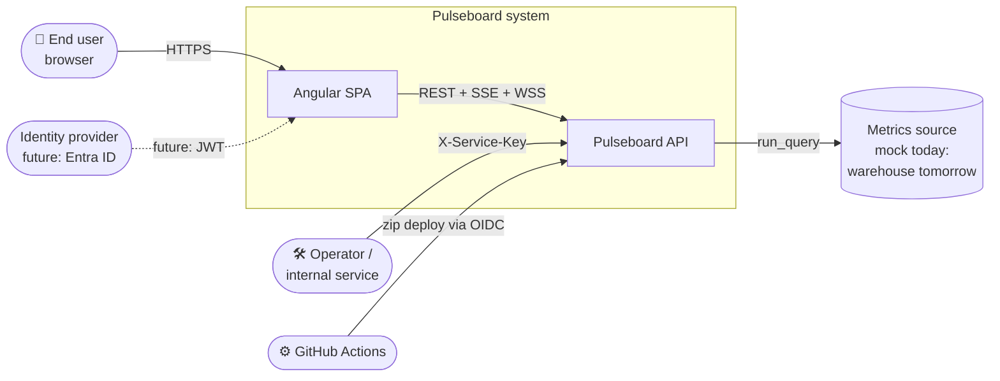

### 2.2 Containers (C4 level 2): production on Azure

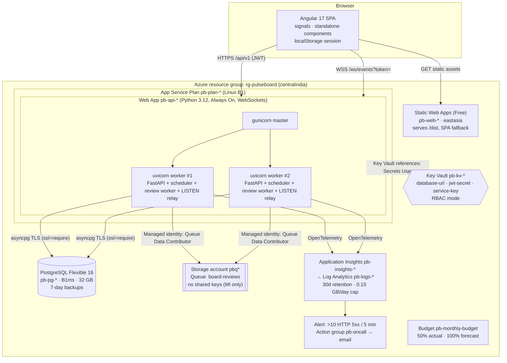

**Why two uvicorn workers on one B1?** `WEB_CONCURRENCY=2` gives parallelism on 1 vCPU while one worker waits on I/O. It also proves the app is **multi-process safe**: the two workers behave like two servers. Each runs its own scheduler, review worker and LISTEN relay, and correctness still holds thanks to `SKIP LOCKED`, claims/generations and pg_notify (sections 7 and 8).

### 2.3 Components (C4 level 3): inside the API

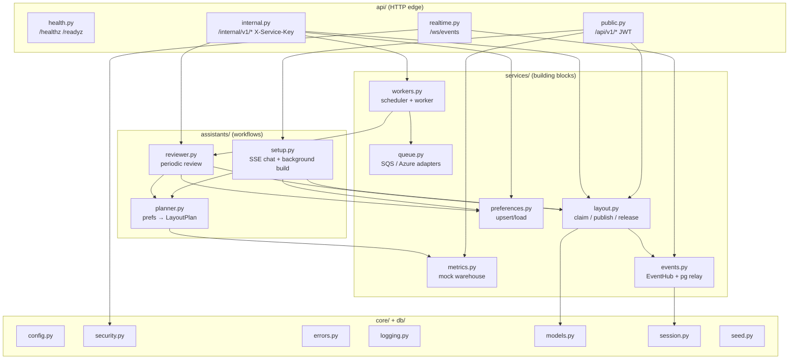

**The rule:** dependencies point **downward only**. `api` never contains business logic, and `services` never import `api`. That's why the assistants can be swapped for an LLM without touching HTTP code.

---

## 3. Repository map

```
pyhon-fastapi-prod-ready-application/
├── pulseboard-api/                       ← BACKEND
│   ├── app/
│   │   ├── main.py                       app factory, middleware, lifespan (startup/shutdown)
│   │   ├── schemas.py                    Pydantic contracts (IO + LayoutPlan)
│   │   ├── core/   config · errors · logging · security
│   │   ├── db/     models · session · seed
│   │   ├── api/    health · public · internal · realtime
│   │   ├── assistants/ setup · reviewer · planner
│   │   └── services/   layout · metrics · preferences · events · queue · workers
│   ├── migrations/                       Alembic (0001_initial_schema)
│   ├── tests/                            pytest + httpx + moto (12 tests)
│   ├── infra/main.bicep                  ALL Azure resources as code
│   ├── infra/secrets.local.json          generated secrets (git-ignored!)
│   ├── scripts/azure-deploy.ps1          one-command infra + code + smoke test
│   ├── scripts/dev.ps1, demo.py          local run + end-to-end walkthrough
│   ├── .github/workflows/ci.yml, deploy.yml
│   ├── Dockerfile, startup.sh, alembic.ini, pyproject.toml, requirements.txt
│   └── docs/PROJECT_GUIDE.md, BACKEND_ARCHITECTURE.md
└── pulseboard-web/                       ← FRONTEND (Angular workspace)
    ├── projects/data-access/             library: ApiService, auth interceptor,
    │                                     LiveEventsService, SessionService, models
    ├── projects/pulseboard/              app: routes, pages, tile card, environments
    │   └── staticwebapp.config.json      SPA fallback + security headers
    └── dist/pulseboard/browser/          build output uploaded to Static Web Apps
```

---

## 4. Frontend (Angular 17)

### 4.1 What and why

| Choice | Why |
|---|---|
| **Angular 17 standalone components** | No NgModules, so less boilerplate. Lazy `loadComponent` per route keeps the first load small. |
| **Signals** (`signal`, `computed`, `effect`, `input()`) | Fine-grained reactivity without RxJS subscriptions everywhere. Live events are just "a signal changed → re-load". |
| **New control flow** (`@if`, `@for`, `@switch`) | Built-in, faster than `*ngIf`, and narrows types in templates. |
| **`data-access` library** split from the app | All API / WebSocket / session code sits behind one public API. A second app (admin, mobile web) can reuse it. |
| **No chart library**: hand-rolled SVG polyline + CSS bars | Zero dependencies and a tiny bundle. The three visuals (STAT/TREND/BREAKDOWN) are simple. |
| **`fetch` for SSE**, not HttpClient / EventSource | `EventSource` can only do GET with no headers. HttpClient can't stream a POST body. `fetch` + `ReadableStream` can do both. |

### 4.2 Frontend component map

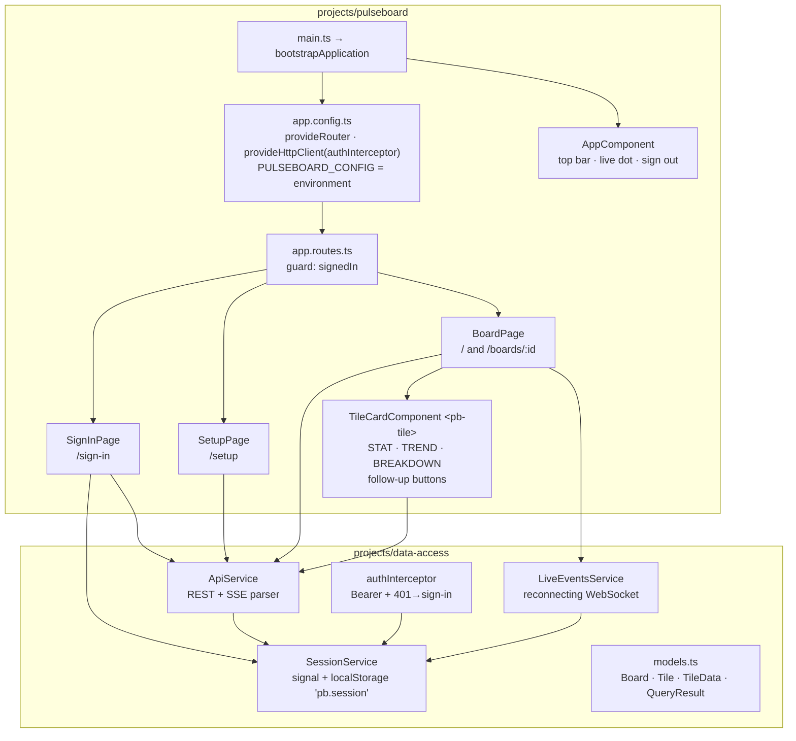

### 4.3 Routing and guards

| Path | Guard | Component | Behaviour |
|---|---|---|---|
| `/sign-in` | none | SignInPage | POST `/auth/dev-token` → store token → go to `/` |
| `/` | `signedIn` | BoardPage (no id) | GET `/boards/overview`. On **404 → redirect to `/setup`** (new user). |
| `/setup` | `signedIn` | SetupPage | Starts a chat (`action: start`). On the `board` event → go to `/` after 700 ms. |
| `/boards/:id` | `signedIn` | BoardPage (id) | Detail or briefing board. Breadcrumb back to the overview. |
| `**` | | redirect `/` | |

`withComponentInputBinding()` maps the `:id` route param straight onto `input<string>()` in BoardPage.

### 4.4 How BoardPage loads (and why it's built that way)

1. `effect` on `id()` → reset data → `load()`.
2. `load()` → board. If `BUILDING`: show "Building your board…" and **poll every 3 s as a fallback** in case the WebSocket is down.
3. If `LIVE` → GET tiles → **one GET `/tiles/{id}/data` per tile, in parallel**. Each tile fills in on its own. A failed tile shows "This tile couldn't load" without breaking the others.
4. Second `effect` on `live.last()`: if an event `board.*` matches this board **or its parent** → reload. A detail page also refreshes when the overview republishes.
5. Tiles are split into `alerts()` (tier ALERT, "Needs attention (n)") and `others()` ("Watching"). An overview with no alerts shows "All clear".

### 4.5 Session and auth on the client
- The token and userId live in a **signal** and are mirrored to `localStorage['pb.session']` (wrapped in try/catch, so they survive privacy mode).
- `authInterceptor` adds `Authorization: Bearer …` to every HttpClient call. A **401 → clear session → /sign-in**.
- SSE uses `fetch`, so it adds the header **manually** (the interceptor doesn't see fetch).
- `LiveEventsService`: an `effect` opens the socket when a token appears and closes it on sign-out. **Ping every 25 s** stops idle proxies dropping it. **Reconnect backoff** 0.5 s → 1 → 2 → … max 30 s. The `connected` signal drives the green dot in the top bar.

### 4.6 Hosting (Static Web Apps)
- `ng build` → `dist/pulseboard/browser` → uploaded to **Azure Static Web Apps (Free)**.
- `staticwebapp.config.json`: `navigationFallback → /index.html` (so deep links like `/boards/123` work on refresh) + `nosniff`, `X-Frame-Options: DENY`, `Referrer-Policy: no-referrer`.
- `environment.prod.ts` hard-codes `apiUrl`/`wsUrl` to the App Service hostname. **Cross-origin**, so the API's CORS list must include the SWA hostname (Bicep does this: `PB_CORS_ORIGINS`).

**What else could serve it?** Blob static website + Front Door, App Service itself (same origin, no CORS), or SWA's *linked backend* feature (Standard tier) so `/api` is proxied on the same origin and CORS goes away.

---

## 5. Backend (FastAPI)

### 5.1 Request pipeline: what happens to every HTTP request

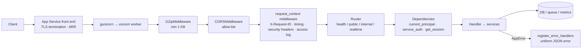

### 5.2 Full API catalogue

| Method | Path | Auth | Who calls it | What it does |
|---|---|---|---|---|
| GET | `/healthz` | – | App Service, Docker HEALTHCHECK | Liveness: `{"status":"ok"}` |
| GET | `/readyz` | – | CI/CD smoke test, ops | `SELECT 1`, 200 or **503** |
| POST | `/api/v1/auth/dev-token` | – (flag) | SignInPage | Issues a JWT for any valid user id |
| POST | `/api/v1/assistant/messages` | JWT | SetupPage | One chat turn, **SSE stream** |
| GET | `/api/v1/boards/overview` | JWT | BoardPage | The user's overview (404 if none) |
| GET | `/api/v1/boards/{id}` | JWT | BoardPage | Any owned board (404 if not owner) |
| GET | `/api/v1/boards/{id}/tiles` | JWT | BoardPage | Tiles ordered by position |
| GET | `/api/v1/tiles/{id}/data` | JWT | BoardPage | Runs `query_spec` (200 with OK/ERROR) |
| PATCH | `/api/v1/tiles/{id}/follow-up` | JWT | TileCard | NONE/PENDING/SEEN/DONE |
| WS | `/ws/events?token=` | JWT in query | LiveEventsService | `connected`, `board.building`, `board.published`, `pong` |
| GET | `/internal/v1/assistant-profiles/{key}` | Service key | Ops / future LLM agent | Agent config |
| POST/GET | `/internal/v1/preferences` | Service key | Agent tools | Upsert / load |
| POST | `/internal/v1/layouts/claim` | Service key | Agent tools | Take the lease |
| POST | `/internal/v1/layouts/{id}/publish` | Service key | Agent tools | Publish a LayoutPlan |
| POST | `/internal/v1/reviews/{id}` | Service key | Ops, demo.py | **Enqueue** a review (202) |
| POST | `/internal/v1/reviews/{id}/run` | Service key | Ops, tests | Run a review **synchronously** |
| GET | `/internal/v1/jobs` | Service key | Ops | Recent assistant jobs |

**Why does `/internal` mirror the agent tool list?** The seeded profiles list tools `save_preference, claim_layout, publish_layout, find_metrics, run_query, project`. When a real LLM agent replaces the rule engine (perhaps running elsewhere, e.g. Azure Functions or a separate agent runtime), it calls these endpoints as its tools. The safety rules (claim/generation) are enforced **server-side**, so even a misbehaving model can't corrupt a board.

### 5.3 Lifespan: startup and shutdown

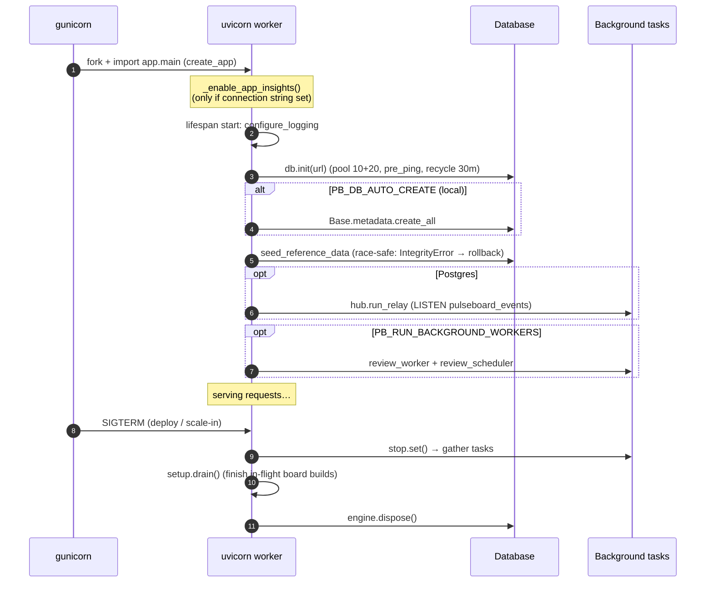

### 5.4 Configuration: every setting

| Env var | Default | Production (Bicep) | Why |
|---|---|---|---|
| `PB_ENVIRONMENT` | local | production | Turns off `/docs`, enforces secret guard |
| `PB_DATABASE_URL` | sqlite file | KV ref → `postgresql+asyncpg://…?ssl=require` | DB portability |
| `PB_DB_AUTO_CREATE` | true | **false** | Prod uses Alembic only |
| `PB_JWT_SECRET` | dev default | KV ref | **Startup fails** if the default is used in prod |
| `PB_SERVICE_KEY` | dev default | KV ref | Same guard |
| `PB_ENABLE_DEV_TOKEN` | true | `enableDemoSignIn` param | Kill switch for demo login |
| `PB_CORS_ORIGINS` | localhost:5173 | SWA host + localhost | Cross-origin SPA |
| `PB_QUEUE_BACKEND` | sqs (moto) | azure | Cloud-agnostic queue |
| `PB_AZURE_QUEUE_ACCOUNT_URL` | – | storage queue endpoint | Managed identity auth |
| `PB_REVIEW_INTERVAL_MINUTES` | 60 | 60 | Freshness |
| `PB_REVIEW_SCHEDULER_INTERVAL_SECONDS` | 30 | 30 | How often to look for due boards |
| `PB_MAX_DELIVERY_ATTEMPTS` | 5 | 5 | Poison message cut-off |
| `PB_CLAIM_SECONDS` | 120 | 120 | Lease length |
| `PB_SETUP_BUILD_DELAY_SECONDS` | 2.0 | 2.0 | Simulated "thinking" |
| `PB_LOG_JSON` | true | true | Machine-parsable logs |
| `WEB_CONCURRENCY` | 2 | 2 | gunicorn workers |
| `APPLICATIONINSIGHTS_CONNECTION_STRING` | – | from AI resource | Enables telemetry |

### 5.5 The planner: how a board is decided

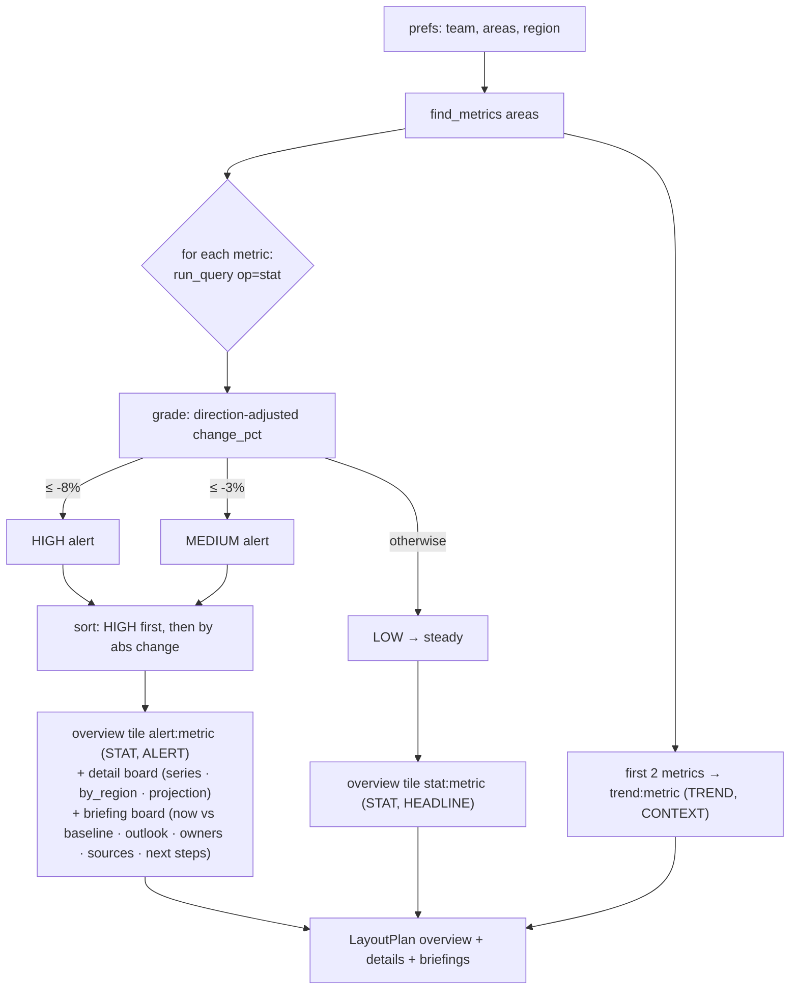

The metrics mock is **deterministic per (metric, region, hour)**, seeded from a SHA-256 hash. Two reads in the same hour agree, the next hour brings "fresh" numbers, and there's a 45% chance of a shock on the latest point so reviews have something to flag.

---

## 6. Database

### 6.1 ER diagram

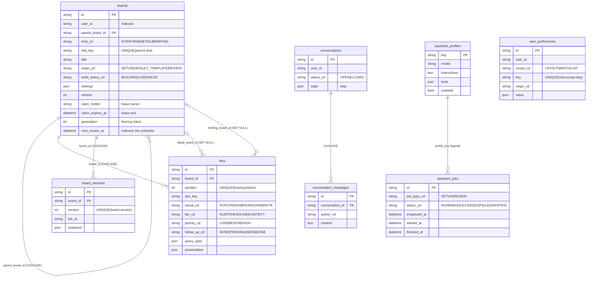

### 6.2 Why each design decision

| Decision | Why | What if not |
|---|---|---|
| UUID string PKs | Generated on any instance, safe to expose, no sequence contention | Integer IDs leak counts and can be guessed |
| Board **family** via self-FK | Overview + details + briefings publish and delete together | Orphans would pile up |
| `UNIQUE(parent_board_id, slot_key)` | Stable identity across rebuilds, so links and bookmarks survive | Every publish would make new IDs and the user's open tab would 404 |
| Claim columns **on the row** | Lock and data in one row, one transaction, no lock table | Separate lock table → two-row consistency problems |
| `generation` integer | Fencing token that rejects zombie writers | Lease alone can't stop a paused process waking up late |
| `next_review_at` indexed | The schedule **is** data, no cron state | Cron would need its own HA and catch-up logic |
| JSON `query_spec`, `presentation`, `settings`, `snapshot` | Shape changes with plans and visuals without migrations | Every new visual would need a migration |
| `board_versions` immutable | Audit trail and rollback | No way to answer "who changed my board?" |
| `*_cd` code columns as strings | Readable in SQL, no enum migrations | |
| `DateTime(timezone=True)` + `as_utc()` | SQLite drops tzinfo, so values are normalised | Naive/aware comparison crashes |

### 6.3 SQLite (local) vs PostgreSQL (prod)

| | SQLite | PostgreSQL Flexible |
|---|---|---|
| Driver | aiosqlite | asyncpg |
| Pragmas / pool | `foreign_keys=ON`, `journal_mode=WAL`, timeout 30 | pool 10 + overflow 20, `pre_ping`, recycle 1800 s |
| `FOR UPDATE` / `SKIP LOCKED` | Ignored (single writer anyway) | Real row locks |
| Realtime fan-out | In-process | `pg_notify` / `LISTEN` |
| Schema | `create_all` | `alembic upgrade head` in `startup.sh` (`render_as_batch` so migrations also work on SQLite) |

### 6.4 Transaction boundaries
- **claim**: one commit (lease + generation++ + BUILDING), then the `board.building` event.
- **publish**: one commit for the whole family: delete old tiles → upsert boards → insert tiles → bump versions → insert versions → clear lease → set `next_review_at`. Then the `board.published` event. **Events are sent after commit**, so a client never re-fetches data that isn't there yet.
- **release**: rollback, then restore LIVE (or FAILED if it was never published).

---

## 7. Queue and background workers

### 7.1 Block diagram

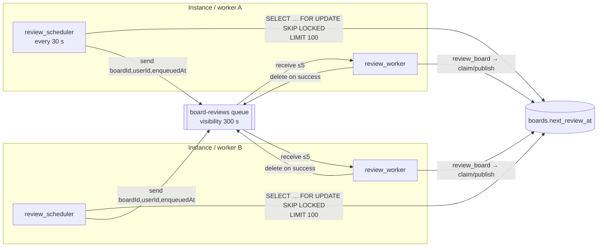

### 7.2 Delivery guarantees

| Situation | What happens | Why it's safe |
|---|---|---|
| Two schedulers tick together | `SKIP LOCKED` hands each a different set of boards | No duplicate enqueues |
| Worker crashes mid-review | Message stays invisible 300 s, then is redelivered | Its claim expires after 120 s, so the retry can claim |
| Review raises | Not deleted → redelivered (attempts++) | Idempotent: publish replaces the whole layout |
| Attempts > 5 | Logged as poison and deleted | One bad board can't block the queue |
| Board being set up | `claim` → Conflict → job `SKIPPED`, message deleted | The user's setup wins |
| Queue down | Worker backs off 1 → 60 s, scheduler logs a warning | Self-healing |
| Duplicate message | Second run claims a new generation, publishes the same plan | At-least-once delivery + idempotent result |

**Adapters:** `SqsQueue` (boto3, long-poll 5 s, moto locally) and `AzureStorageQueue` (managed identity via `DefaultAzureCredential`, or a connection string for Azurite). Both use `asyncio.to_thread` because the SDKs are synchronous.

**Where else?** Azure Service Bus (dead-letter queue built in, sessions, scheduled messages, so the scheduler loop could disappear), Event Grid, Celery/RQ + Redis, or Postgres-as-a-queue (`SKIP LOCKED` on a jobs table, one less service).

---

## 8. Realtime

Three channels, each picked for a reason:

| Channel | Direction | Used for | Why this one |
|---|---|---|---|
| **REST** | client → server | Reads, follow-ups, sign-in | Cacheable, simple |
| **SSE over POST** | server → client, one turn | Assistant reply streaming | Plain HTTP, sends the auth header, closes cleanly per turn, LLM-ready |
| **WebSocket** | server → client, long-lived | `board.building` / `board.published` | Push without polling, lasts the whole session |

### Cross-instance fan-out

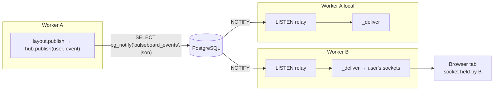

- `clientAffinityEnabled: false` (no sticky sessions) is **fine** because any instance can deliver any user's event.
- Relay reconnects with backoff of 1 s up to 30 s. While it's down, `_relay=False`, so delivery is local-only (degraded but alive).
- If `pg_notify` fails, the event is delivered locally rather than dropped.
- **Limit:** a NOTIFY payload is ≤ 8000 bytes. Events here are tiny (`type, boardId, version`), so it's fine.

---

## 9. Sequence diagrams

### 9.1 Sign-in

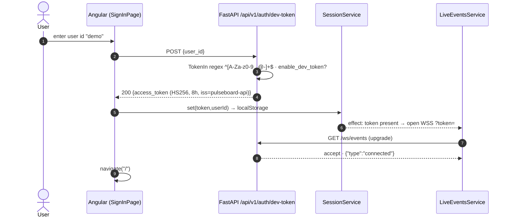

### 9.2 First visit: overview 404 → setup

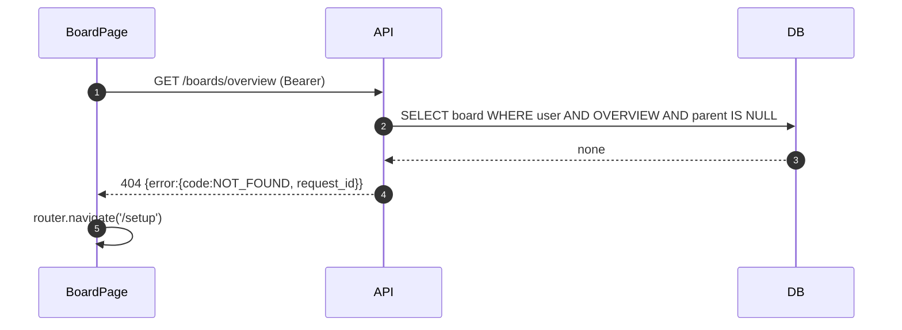

### 9.3 Setup conversation (SSE) + background build

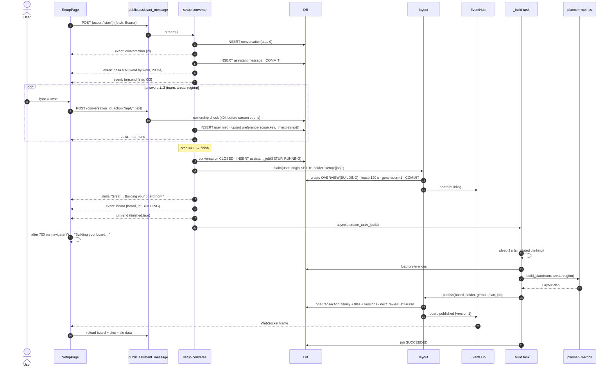

**"Skip" branch:** a skip at step 0 → origin `DEFAULT_TEMPLATE` and default areas `sales, customers, operations`, region ALL.

### 9.4 Viewing a board (tile fan-out)

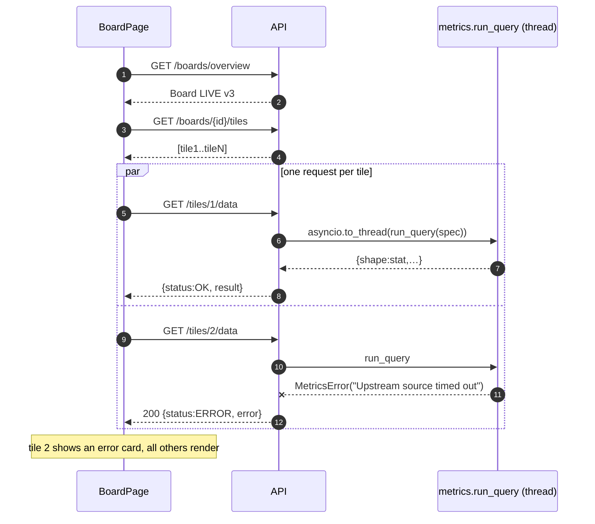

### 9.5 Scheduled review (scheduler → queue → worker)

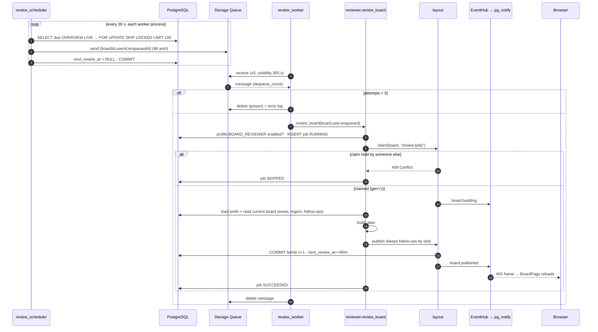

### 9.6 The fencing token stopping a zombie writer

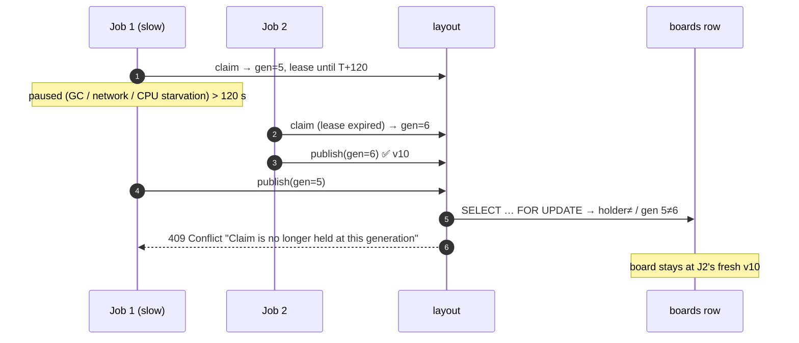

### 9.7 Follow-up update

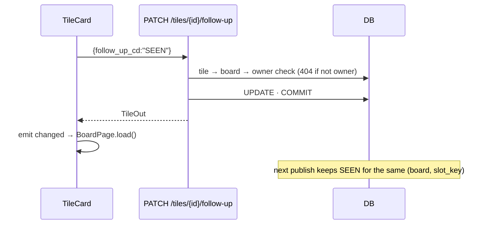

### 9.8 Deploy (manual script and CI/CD)

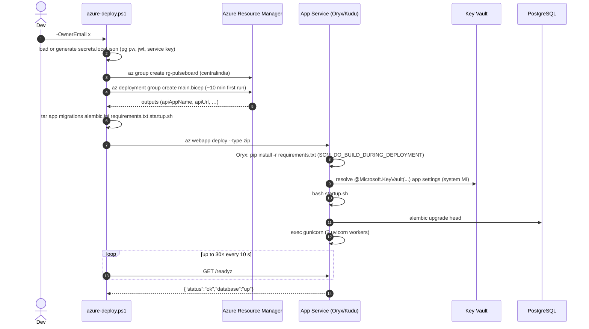

---

## 10. State machines

### Board build status
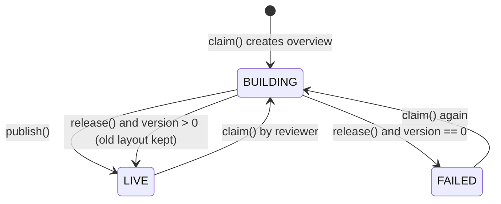

### Assistant job
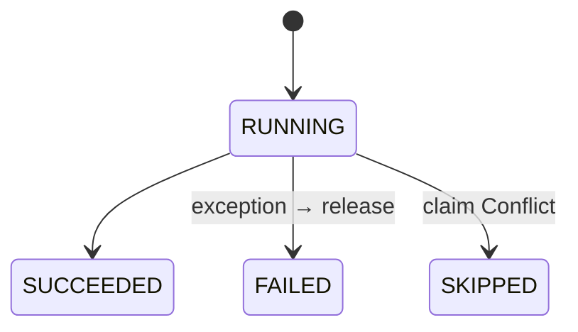

### Tile follow-up
```mermaid
stateDiagram-v2
    [*] --> NONE
    NONE --> PENDING: plan
    NONE --> SEEN: user
    PENDING --> SEEN: user
    SEEN --> DONE: user
    NONE --> DONE: user
    PENDING --> DONE: user
```

### Conversation
```mermaid
stateDiagram-v2
    [*] --> OPEN: start
    OPEN --> OPEN: reply (step++)
    OPEN --> CLOSED: step 3 or skip
    CLOSED --> [*]: further turns → 409
```

---

## 11. Azure deployment

### 11.1 Resource inventory (from `infra/main.bicep`)

| Resource | Name | SKU / setting | Why this SKU | Cost note |
|---|---|---|---|---|
| Log Analytics | `pb-logs-*` | PerGB2018, 30 days, **0.15 GB/day cap** | Stays inside the free 5 GB/month | ~free |
| App Insights | `pb-insights-*` | workspace-based, **50% sampling** | Halves ingestion | ~free |
| Action group | `pb-oncall` | email `ownerEmail` | Alerts go to a human | free |
| PostgreSQL Flexible | `pb-pg-*` | **Standard_B1ms Burstable**, v16, 32 GB, no autogrow, 7-day backup, no HA, no geo | Free-tier 750 h eligible | lowest |
| Firewall rule | AllowAzureServices | 0.0.0.0–0.0.0.0 | Lets App Service connect without VNet | ⚠ see §18 |
| Storage account | `pbq*` | Standard_LRS, TLS1.2, **no shared key**, no public blob | Managed-identity-only queue | cents |
| Queue | `board-reviews` | | | |
| Key Vault | `pb-kv-*` | standard, **RBAC**, soft delete 7 d | Secrets out of app settings | cents |
| Static Web App | `pb-web-*` | **Free**, eastasia (SWA region list is limited) | Global CDN for the SPA | free |
| App Service plan | `pb-plan-*` | Linux **B1** | Cheapest tier with **Always On** (background workers need a warm process) | main cost |
| Web App | `pb-api-*` | Python 3.12, system MI, httpsOnly, Always On, **WebSockets on**, HTTP/2, FTPS off, TLS1.2, healthCheckPath `/healthz`, no ARR affinity | | |
| Role: KV Secrets User | API MI → vault | | Resolve KV references | |
| Role: Queue Data Contributor | API MI → storage | | Send/receive/delete | |
| Metric alert | `pb-api-5xx` | >10 Http5xx in 5 min, sev 2 | | |
| Budget | `pb-monthly-budget` | default 2000, 50% actual / 100% forecast | No surprise bills | |

### 11.2 Identity and secret flow (who can talk to whom)

```mermaid
flowchart LR
    subgraph GH[GitHub]
      ACT[deploy.yml]
    end
    ENTRA[(Microsoft Entra ID)]
    APP[Web App<br/>System-assigned MI]
    KV{{Key Vault}}
    SQ[[Storage Queue]]
    PG[(PostgreSQL)]

    ACT -- "OIDC federated token<br/>(no stored password)" --> ENTRA
    ENTRA -- "access token → deploy rights" --> APP
    APP -- "MI token" --> ENTRA
    APP -- "Key Vault Secrets User" --> KV
    KV -- "database-url, jwt-secret, service-key<br/>→ PB_* env vars" --> APP
    APP -- "Queue Data Contributor (MI, no keys)" --> SQ
    APP -- "user/password from KV secret · TLS" --> PG
```

**Why managed identity everywhere possible:** no connection strings to leak or rotate for the queue. Storage has `allowSharedKeyAccess: false`, so **keys can't be used even if leaked**.
**Why Postgres still uses a password:** the simplest setup on the free tier. The next step is **Entra authentication for PostgreSQL** with the same managed identity, so the password goes away.

### 11.3 Network path

```mermaid
flowchart LR
    B[Browser] -- HTTPS --> SWAE[SWA global edge] 
    B -- "HTTPS / WSS (TLS 1.2+)" --> FE[App Service front end<br/>*.azurewebsites.net]
    FE -- HTTP (internal) --> W[Worker instance :8000<br/>forwarded-allow-ips=*]
    W -- "public endpoint + TLS<br/>firewall: Azure services" --> PG[(Postgres)]
    W -- HTTPS --> SQ[(queue.core.windows.net)]
    W -- HTTPS --> AI[(App Insights ingestion)]
```

Timeouts to know:
- App Service front end idle timeout is about **230 s** for HTTP. The SSE turns are short, so that's fine. WebSocket stays up thanks to the **25 s ping**.
- gunicorn `--timeout 120`, `--graceful-timeout 30`, `--keep-alive 75`.

### 11.4 Scaling path

| Stage | Change | Unlocks |
|---|---|---|
| Today | B1, 1 instance, 2 workers | ~low hundreds of concurrent users |
| 1 | `appServiceSku=S1` or `P0v3` | **Autoscale** rules, **deployment slots** (blue/green) |
| 2 | Scale out to N instances | Already safe: SKIP LOCKED, fencing, pg_notify, no affinity |
| 3 | `PB_RUN_BACKGROUND_WORKERS=false` on web; separate worker app | API latency isolated from reviews |
| 4 | Postgres General Purpose + zone-redundant HA + read replica | DB resilience |
| 5 | Azure Web PubSub / SignalR for sockets | 10k+ sockets |
| 6 | Front Door + WAF in front of both | Global edge, DDoS/WAF, single origin |

---

## 12. CI/CD

```mermaid
flowchart LR
    DEV[git push / PR] --> CI
    subgraph CI["ci.yml (every push & PR)"]
      C1[checkout] --> C2[setup-python 3.12 + pip cache]
      C2 --> C3["pip install -e .[dev]"]
      C3 --> C4[ruff check .]
      C4 --> C5[pytest -q<br/>moto for SQS]
    end
    CI -->|success on main| CD
    subgraph CD["deploy.yml (workflow_run or manual)"]
      D1[environment: production<br/>can require approval] --> D2[azure/login OIDC]
      D2 --> D3[zip app migrations alembic.ini requirements.txt startup.sh]
      D3 --> D4[azure/webapps-deploy]
      D4 --> D5[curl /readyz retry 10×15s]
    end
    CD --> PROD[(App Service)]
```

**Secrets needed:** `AZURE_CLIENT_ID`, `AZURE_TENANT_ID`, `AZURE_SUBSCRIPTION_ID` (with a federated credential on an app registration). **Variable:** `AZURE_WEBAPP_NAME`.

**Why `workflow_run`:** deploy happens *only* when CI succeeded on `main`. Nobody can ship red builds. **Why the smoke test hits `/readyz`, not `/healthz`:** it proves the DB secret resolved and migrations ran, not just that the process started.

**Not in the pipeline today (do these next):**
- Frontend build and deploy (SWA GitHub Action or `swa deploy`). Today it's manual from `dist/`.
- `mypy` (configured in pyproject but not run in CI).
- Infra deploy (`az deployment group what-if` on PR, apply on main).
- Slot swap for zero-downtime deploys (needs S1+).
- The Docker image isn't used by App Service (it uses code deploy + Oryx). The Dockerfile is for portability (ACA, AKS, local).

---

## 13. Security

### 13.1 Trust boundaries

```mermaid
flowchart TB
    subgraph Z0[Untrusted: internet]
      BR[Browser]
    end
    subgraph Z1[User zone: JWT]
      PUB[/api/v1/*, /ws/events/]
    end
    subgraph Z2[Service zone: X-Service-Key]
      INT[/internal/v1/*/]
    end
    subgraph Z3[Platform zone: managed identity]
      KV & SQ & PG
    end
    BR --> PUB
    BR -. "should NOT reach (gateway / IP restriction)" .-> INT
    PUB --> Z3
    INT --> Z3
```

### 13.2 Controls checklist

| Control | Where | Status |
|---|---|---|
| HTTPS only, TLS ≥1.2, FTPS off | Bicep | ✅ |
| JWT HS256, `iss` check, 8 h expiry | security.py | ✅ |
| Prod refuses default secrets | config.py validator | ✅ |
| Constant-time service-key compare | internal.py | ✅ |
| Ownership → **404 not 403** | public.py `_owned` | ✅ (no ID enumeration) |
| Input validation (Pydantic, regex user id, max 2000 chars) | schemas.py | ✅ |
| CORS allow-list, limited methods/headers | main.py | ✅ |
| Security headers (API + SWA) | main.py, staticwebapp.config.json | ✅ |
| No stack traces to clients | errors.py | ✅ |
| Non-root container | Dockerfile | ✅ |
| Secrets in Key Vault, MI access | Bicep | ✅ |
| Queue keyless | Bicep | ✅ |
| `/docs` off in prod | main.py | ✅ |
| Real identity provider | – | ❌ dev-token (demo) |
| `/internal` hidden from internet | – | ⚠ only protected by key, still publicly routable |
| Rate limiting / WAF | – | ❌ |
| JWT in WS query string | realtime.py | ⚠ may appear in proxy logs. Use a short-lived WS ticket. |
| Token in localStorage | session.service.ts | ⚠ XSS-readable. Consider BFF + httpOnly cookie. |
| Postgres public endpoint + "Allow Azure services" | Bicep | ⚠ allows *any* Azure tenant's IPs to try. Use VNet + private access. |
| `secrets.local.json` plaintext on dev machine | scripts | ⚠ git-ignored, but keep it off shared drives, or read from KV |

---

## 14. Observability

| Signal | How | Where to look |
|---|---|---|
| Request logs | JSON: `request_id, method, path, status, ms` | App Insights → traces / `az webapp log tail` |
| Correlation | `X-Request-ID` in, out, on every log and every error body | Paste the ID from a UI error into a Logs query |
| Exceptions | `log.exception` → OpenTelemetry | App Insights → Failures |
| Job health | `assistant_jobs` table + `GET /internal/v1/jobs` | queue latency = `started_at - enqueued_at` |
| Liveness / readiness | `/healthz` (platform restarts), `/readyz` (smoke test) | App Service Health check blade |
| Alerting | >10 × 5xx / 5 min → email | Azure Monitor |
| Cost | Budget alerts at 50% / forecast 100% | Cost Management |

Example KQL:
```kusto
traces
| where customDimensions.request_id == "<id from UI>"
| order by timestamp asc
```

---

## 15. Local vs production

```mermaid
flowchart LR
    subgraph Local["Local (scripts/dev.ps1)"]
      NG["ng serve :5173"] --> UV["uvicorn :8000"]
      UV --> SQL[(pulseboard.db SQLite WAL)]
      UV --> MOTO[["moto server :5000 (fake SQS)"]]
    end
    subgraph Prod["Azure"]
      SWA2[Static Web Apps] -.-> API2[App Service gunicorn×2]
      API2 --> PG2[(Postgres Flexible)]
      API2 --> AQ[[Storage Queue]]
      API2 --> KV2{{Key Vault}}
    end
```

| Concern | Local | Prod |
|---|---|---|
| DB | SQLite, auto-create | Postgres, Alembic |
| Queue | moto SQS (`testing` creds) | Azure Storage Queue, MI |
| Realtime | in-process | pg_notify |
| Logs | plain text (`PB_LOG_JSON=false`) | JSON → App Insights |
| Docs | `/docs` Swagger | disabled |
| Secrets | `.env` defaults | Key Vault |
| E2E check | `python scripts/demo.py` | `python scripts/demo.py https://<app> <service-key>` |

---

## 16. What if…

| # | What if… | What happens today | Impact | Better |
|---|---|---|---|---|
| 1 | Instance dies **during the setup `_build`** | Background task lost. Lease expires after 120 s, but board stays **BUILDING** with version 0, and the scheduler only picks LIVE boards. | ⚠ New user sees "Building…" forever | Route setup builds through the queue too, or add a sweeper for expired BUILDING claims |
| 2 | Instance dies during a review | Message redelivered after 300 s | Board shows old version until then | ✅ |
| 3 | Queue unavailable | Scheduler fails to send. Boards already had `next_review_at=NULL` only if the send succeeded (send happens before clearing). Tick is retried. | Reviews delayed | ✅ |
| 4 | Postgres down | `/readyz` 503, API 500s, alert fires, relay reconnects with backoff | Outage | HA / zone-redundant |
| 5 | Key Vault reference fails | App settings stay literal `@Microsoft.KeyVault(...)`, prod guard / DB URL fails, app won't start, health check fails | Deploy fails visibly | ✅ fail-fast |
| 6 | Two tabs, same user | Both sockets get events | ✅ | |
| 7 | WebSocket blocked by a corporate proxy | Green dot off. BoardPage still polls while BUILDING, otherwise needs a manual refresh. | Minor | SSE fallback for events |
| 8 | JWT expires mid-session | Next REST call 401 → sign-in. WS closes and reconnect fails (1008) while the token is in storage. | Re-login | Refresh tokens |
| 9 | Metric source slow or broken | That tile shows ERROR | ✅ isolation | Timeouts + cache |
| 10 | Deploy while users are connected | SIGTERM → graceful 30 s, drain builds. Sockets drop and the client reconnects with backoff. | Blip | Slots (S1+) |
| 11 | Multiple instances run `alembic upgrade` at once | Possible migration race on scale-out | ⚠ | Run migrations as a separate CD step |
| 12 | Someone steals the service key | Full internal API access | 🔴 | Network-restrict `/internal`, rotate via KV, MI-based auth |
| 13 | Spike of 10k users | B1 CPU saturates, 1 Postgres B1ms connection pool (2 workers × 30 max) | Slow | Scale tier, PgBouncer, separate workers |
| 14 | User edits a follow-up during a review | Publish keeps the prior follow-up per (board, slot) unless the plan sets one | ✅ (last-write small race window) | |
| 15 | A clock skews between instances | Leases compare against each instance's `utcnow()` | Small | Use DB `now()` for leases |
| 16 | Budget exceeded | Email only (budgets don't stop resources) | Cost | Automation runbook to stop the app |

---

## 17. Alternatives

| Area | Chosen | What else | When to switch |
|---|---|---|---|
| API framework | FastAPI | Django + DRF, Flask, Litestar, Node/NestJS | Need admin/ORM batteries → Django |
| Server | gunicorn + uvicorn | uvicorn `--workers`, Hypercorn, Granian | – |
| Compute | App Service B1 | **Azure Container Apps** (scale to zero, KEDA queue scaling, Dockerfile ready), AKS, Functions (for reviewer) | Want queue-driven autoscale → ACA |
| DB | Postgres Flexible | Azure SQL, Cosmos DB (JSON docs suit boards) | Global multi-region → Cosmos |
| Queue | Storage Queue | Service Bus (DLQ, scheduled delivery), Event Grid | Need a DLQ / ordering → Service Bus |
| Realtime | WS + pg_notify | Azure Web PubSub, SignalR, Redis pub/sub, SSE-only | Thousands of sockets |
| Scheduler | DB-driven loop | Service Bus scheduled messages, Functions timer, Logic Apps | Removing worker loops |
| Auth | dev JWT | Entra ID / External ID, Auth0, Keycloak | Before real users |
| FE hosting | SWA Free | Blob + Front Door, App Service | Need same-origin API → SWA Standard linked backend |
| FE framework | Angular 17 | React, Vue, Svelte | Team skills |
| IaC | Bicep | Terraform, Pulumi, azd | Multi-cloud → Terraform |
| Secrets | Key Vault refs | App Configuration + KV | Feature flags |
| Assistant | rules engine | Claude via the Anthropic API, producing a `LayoutPlan` JSON that's validated by Pydantic and published through claim/publish | Product wants natural-language understanding |

---

## 18. Gaps and roadmap

**P0 (before real users)**
1. Real identity provider (Entra ID). Turn off `PB_ENABLE_DEV_TOKEN`.
2. Block `/internal/v1` from the internet (App Service access restrictions / APIM / separate app).
3. Fix stuck-BUILDING on first setup (what-if #1).
4. Postgres: VNet integration + private access, Entra auth.

**P1 (reliability)**
5. Migrations as a dedicated CD step. Slots for zero-downtime deploys.
6. Frontend CI/CD to SWA. `mypy` in CI. Bicep `what-if` on PR.
7. Short-lived WebSocket tickets instead of the JWT in the query string.
8. Rate limiting (APIM / Front Door WAF).

**P2 (scale and product)**
9. Separate worker app (ACA with KEDA on queue length).
10. Batch tile-data endpoint + cache.
11. Replace the planner with an LLM. Keep `LayoutPlan` as the contract.
12. Real warehouse connector behind the `metrics` interface.

---

## 19. Glossary

| Term | Meaning |
|---|---|
| **Board family** | One OVERVIEW plus its DETAIL and BRIEFING children |
| **Slot key** | Stable logical name of a board or tile (`alert:sales.bookings`), so identity survives rebuilds |
| **Claim / lease** | Temporary exclusive right to rebuild a board (120 s) |
| **Generation** | Counter bumped on each claim. Publish must present the current one (fencing token). |
| **LayoutPlan** | Pydantic object describing the whole board family: the only thing an assistant produces |
| **Tier** | ALERT (needs attention) / HEADLINE (steady KPI) / CONTEXT (trend) |
| **Grade** | Direction-adjusted change → HIGH (≤-8%), MEDIUM (≤-3%), LOW |
| **Poison message** | A queue message that failed more than 5 times and gets dropped |
| **MI** | Managed identity: an Azure-issued identity for the app, no secrets |
| **KV reference** | `@Microsoft.KeyVault(SecretUri=…)` app setting resolved by App Service at startup |
| **SKIP LOCKED** | Postgres row-lock mode that lets parallel schedulers split work |
| **SSE** | Server-Sent Events: a one-way HTTP stream (`event:` / `data:` lines) |

---

**In one line:** an Angular SPA on Static Web Apps talks to a stateless FastAPI service on App Service. The service keeps every board correct through **lease + fencing-token publishing**, keeps boards fresh through a **DB-driven scheduler + Storage Queue**, pushes changes live through **WebSockets fanned out with Postgres NOTIFY**, and runs on keyless, Key-Vault-backed, Bicep-defined Azure infrastructure with CI-gated deploys.

## 20. Version 2: catalog, Redis, navigation, Docker, CI

> In-depth guides: [`CACHING_AND_PERFORMANCE.md`](pulseboard-api/docs/CACHING_AND_PERFORMANCE.md) (Redis keys, invalidation, N+1 fixes)
> and [`RUNBOOK.md`](pulseboard-api/docs/RUNBOOK.md) (local, Docker, Azure, CI/CD, troubleshooting).

### 20.1 Nothing hardcoded
| Data | Source |
|---|---|
| Metric catalog (title, unit, owners, sources, direction, typical level, volatility) | `metrics` table (migration `0002`). Seeded once from `app/db/seed_metrics.py` when the table is empty, then managed in the UI. |
| Setup questions: area choices | Distinct `area` values of enabled metrics |
| Setup questions: region choices, units, page sizes | Settings `PB_REGIONS`, `PB_UNITS`, `PB_PAGE_SIZES`, served by `GET /api/v1/meta` |
| Which units are counts or volumes | `PB_COUNT_UNITS`, `PB_VOLUME_UNITS` |
| UI menus and filters (board kinds, job types and statuses, follow-ups) | `GET /api/v1/meta` |
| UI API endpoints | `/config.json`, read at runtime. The deploy writes it per environment, so one build runs everywhere. |
| Answer matching | Catalog area names and metric-title words, not a fixed synonym list |

### 20.2 API added in version 2
| Method | Path | Notes |
|---|---|---|
| GET | `/api/v1/meta` | regions, units, areas, page sizes, enums |
| GET | `/api/v1/metrics?q&area&enabled&sort&desc&page&size` | search, filter, sort, paginate; `cached` flag |
| GET / POST / PUT / DELETE | `/api/v1/metrics[/{key}]` | full CRUD; 201, 409 on duplicate, 422 on validation error, 204 on delete |
| GET | `/api/v1/metrics/areas` | distinct areas |
| GET | `/api/v1/boards?q&kind&page&size` | the user's boards with tile and alert counts (one `GROUP BY`) |
| GET | `/api/v1/boards/{id}/tile-data` | **every tile's data in one call** (replaces N per-tile calls) |
| GET | `/api/v1/jobs?job_type&status&page&size` | the user's setup and review history |

### 20.3 Redis cache (cache-aside)
| Key | TTL | Invalidated by |
|---|---|---|
| `catalog:v1` | 5 min | metric create, update or delete |
| `metrics:list:*` | 60 s | metric write |
| `board:<id>` | 5 min (never while `BUILDING`) | publish (whole family), release |
| `tiles:<board>` | 5 min | publish, follow-up change |
| `tile:<tile>:<hour>` | 5 min | metric write; hourly rollover |
| `boards:<user>:*` | 60 s | publish for that user |

`PB_CACHE_BACKEND` sets the mode:
- `redis`: shared, used in Docker, CI and Azure with `-DeployRedis`.
- `memory`: single process only, used for local runs and tests.
- `none`: caching off, the Azure default, correct with any number of workers.

Any Redis failure falls back to the database. Ownership is re-checked on every cached read.

### 20.4 N+1 fixes
| Before | After |
|---|---|
| One HTTP request per tile (each doing 2 SQL lookups and a catalog load) | `GET /boards/{id}/tile-data`: 1 SQL query, 1 `MGET`, 1 pipelined `SET` |
| Tile, then board, to check ownership (2 queries) | One `JOIN` |
| Per-board count queries for "My boards" | One `GROUP BY` with `SUM(CASE …)` |
| One SQS call per due board | `send_message_batch`, 10 per call |

A test counts SQL statements: the batch endpoint runs at most 3 statements cold and 1 warm, however many tiles there are.

### 20.5 Frontend
- **Angular 17 monorepo:** the `pulseboard` app plus the `data-access` library.
- **Sidebar:** Overview · My boards · Metric catalog · Activity · Setup assistant. The active link is highlighted, and the sidebar collapses to a top bar on phones.
- **Live status:** the sidebar footer shows WebSocket status, the user, and sign-out.
- **Guided setup:** a progress bar and clickable answer chips built from `/meta`.
- **Orientation:** every page has a one-line explanation, boards show breadcrumbs (`Overview › Detail`), and the overview has a priority legend.
- **Feedback:** toasts for saves, deletes, errors and `board.published` events.
- **Lists:** a shared pager whose page sizes come from `/meta`.
- **Dates:** every API timestamp is ISO-8601 UTC with an offset, so it parses the same on SQLite and Postgres.

### 20.6 Realtime
| Channel | Use |
|---|---|
| SSE (`POST /assistant/messages`) | Setup-assistant replies stream word by word |
| WebSocket `/ws/events` | `board.building`, `board.published`. Boards refetch, Activity refreshes, a toast appears. Backoff reconnect, ping every 25 s. |
| Postgres `LISTEN/NOTIFY` | Relays events between instances and workers |

### 20.7 Docker and CI
- **`docker compose up --build`** runs postgres:16, redis:7, moto (mock AWS SQS), the API (multi-stage, non-root, healthcheck, Alembic on start) and the web image (Node build, then unprivileged nginx with SPA fallback and `config.json` from env).
- **API CI:** ruff, pytest, and an integration job that runs the image against real Postgres, Redis and moto, then runs `scripts/demo.py`.
- **Web CI:** builds the app, the library and the Docker image.
- **Deploy workflows:** idle until the Azure secrets and variables are set.

### 20.8 Azure, without surprise costs
- `azure-deploy.ps1` resumes everything after a pause.
- `azure-stop.ps1` stops the API, moves the plan to F1 and stops Postgres.
- Redis is opt-in with `-DeployRedis`.
- A monthly budget alert and a 5xx alert email the owner.
